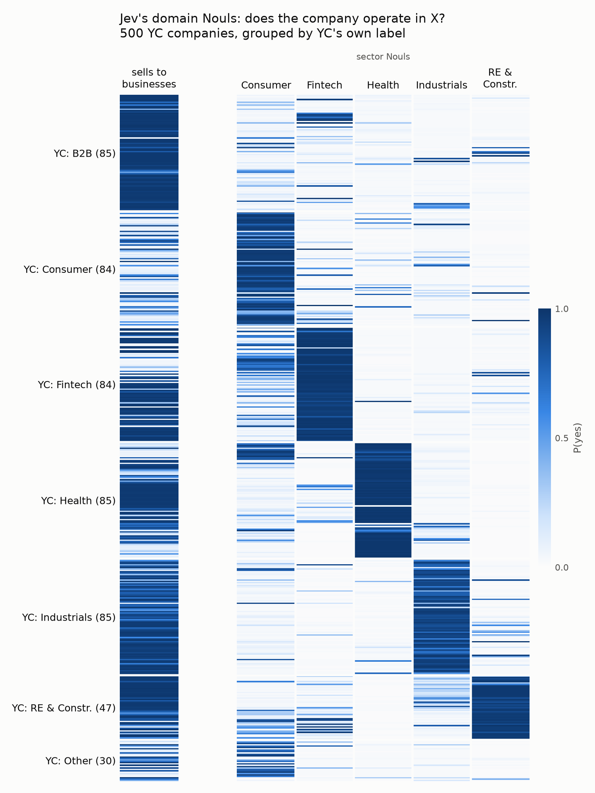

# Decision models in practice – research report

**How this report was made.** The tables are generated; the prose is not. Every table in sections 2, 4 and 5 is copied unedited from the output of `uv run report all`, a deterministic command that reads only the committed files in `data/`, never calls a model and needs no API key. The text around the tables was written by an AI agent (Claude Code) working from that output and the committed data files. Rerunning the command (`uv sync`, then `uv run report all > out.md`) reproduces the tables, not the text. To check a number in the prose, find it in that output; the label distribution, body lengths and batch counts are counted instead from the committed data file named next to them, and the mirror's size and pool sizes on 2026-10-09 come from the mirror itself and cannot be checked from the repository. Demo 1 prints one line saying its data is absent: the demo 1 numbers in this report come from the owner's local run and cannot be reproduced from the repository.

This report documents the three demos in the `decisions-demo` repository so that a writer with no access to the repository can cite them. The tables were produced on 2026-10-12 by `uv run report all` in a checkout holding only the committed data; nothing is quoted from memory. Where the repository cannot support a claim, the report says so.

Terminology: Jev is TypeSafe's decision model, addressed as `typesafe:jev-latest`. Luna is OpenAI's `gpt-6-luna` through its Decisions API, in public beta since 2026-10-06. Sonnet is Anthropic's `claude-sonnet-5-5`, Opus is `claude-opus-5-5`. "Thinking on" and "thinking off" are Anthropic's adaptive thinking setting, which in this harness also changes how the schema is sent (section 1). L1 means the domain level of demo 3's taxonomy, L2 the subindustry level. A "band" or "routing rule" is the confidence region in which a decision model's answer is discarded and Sonnet's is used instead.

## 1. Setup

### Models and versions

| Role | Backend name in the code | Model string sent | Thinking | Notes |
|---|---|---|---|---|
| Decision model 1 | `jev` | `typesafe:jev-latest` | none | Resolves to `jev-1.13.0` per TypeSafe's models page (fetched 2026-10-09) and genai-prices' alias table. The responses do not record the resolved version. |
| Decision model 2 | `luna` | `gpt-6-luna` on `POST /v1/decisions` | none | Through the repository's own adapter `core/luna.py`; Pydantic AI has no Decisions model. Public beta. |
| Same weights, text path | `luna_fallback` | `openai:gpt-6-luna` | n/a (structured outputs) | Demo 1 comparison run only. |
| Language model | `sonnet` | `anthropic:claude-sonnet-5-5` | per demo: off in demos 2 and 3 | Also the escalation target for routed items. |
| Language model, fixed | `sonnet_thinking` | `anthropic:claude-sonnet-5-5` | adaptive, on | Demo 3 comparison on 100 companies; demo 2 partner notes. |
| Language model, fixed | `sonnet_no_thinking` | `anthropic:claude-sonnet-5-5` | off (`between_tools`) | Demo 1 comparison run only. |
| Judge | `opus` | `anthropic:claude-opus-5-5` | adaptive, effort high | Demo 3 adjudication. |
| Data generator | – | `openai:gpt-6.1-sol`, reasoning effort medium | reasoning model | Demo 2's emails and labels. The API reported `gpt-6.1-sol` for all 50 emails. |

Software: Python 3.12.13; `pydantic-ai-slim` 2.52.0 with the `anthropic`, `openai`, `typesafe` and `logfire` extras (the lock file; a comment in `core/luna.py` mentions 2.54, the lock is authoritative); `pydantic` 2.13.5; `openai` 3.26.1; `typesafe-sdk` 0.7.2; `genai-prices` 0.1.9; `httpx2` 2.13.1; `logfire` 5.1.1; `matplotlib` 3.11.2. Source: `uv.lock`.

Thinking changes the request, not only the effort. With thinking off, the 5.5 models reject `disabled`, so the harness sends `{"type": "between_tools"}`; the schema goes as a tool definition verbatim, prompt-cached (`anthropic_cache_tool_definitions`), and because the 5.5 models cannot be forced to call a tool, Sonnet first writes a short visible rationale and then calls it. The answer is only the tool call's arguments; the rationale is stored per row. With thinking on, Pydantic AI uses native structured output in strict mode, uncached. Source: `src/decisions_demo/core/backends.py`, `claude_settings`.

### Prices

Cost is computed per row from recorded tokens with genai-prices 0.1.9, pinned in `uv.lock`, so every machine gets the same numbers offline; `PRICE_OVERRIDES` in `core/report.py` takes precedence for models genai-prices does not know or prices wrong. Jev and Luna bill input only; the harness records no output or cache tokens for Luna.

| Model | Priced as (genai-prices id) | Input USD/M | Output USD/M | Cache read USD/M | Cache write USD/M | Verification |
|---|---|---|---|---|---|---|
| `jev-latest` | `jev-1.13.0` | 0.042 | 0 | – | – | Matches TypeSafe's models page fetched 2026-10-09 ("$42 per Btok / $0.042 per Mtok, output tokens are free"). Verified. |
| `gpt-6-luna` (Decisions API) | `gpt-6-luna` chat entry | 0.10 (0.20 above 272K input) | 0.50, never billed here | 0.01, never recorded | 0.125, never recorded | Matches OpenAI's Decisions guide fetched 2026-10-09 ("input costs $0.10 per 1M tokens, no cache-read, cache-write, or output-token charges"). Verified. No request here exceeds 272K tokens. |
| `claude-sonnet-5-5` | override in `core/report.py` (genai-prices would match `claude-sonnet-5` by prefix) | 2.00 | 10.00 | 0.10 | 2.50 | Anthropic's listed rate for Sonnet 5.5 as of 2026-10-09. Verified. genai-prices 0.1.9 has no Sonnet 5.5 entry and its prefix match to Sonnet 5 would charge 0.20 for cache reads; the other three rates are the same. |
| `claude-opus-5-5` | `claude-opus-5-5` | 4.00 | 20.00 | 0.20 | 5.00 | genai-prices entry dated for 5.5. Not independently verified here. |
| `gpt-6.1-sol` | override in `core/report.py` (not in genai-prices 0.1.9) | 2.00 | 10.00 | 0.10 | 2.50 | Hand-typed override in `core/report.py` from OpenAI's list price on 2026-10-06. Placeholder. Affects only demo 2's one-off generation cost. |

Source: `src/decisions_demo/core/report.py` (`MODELS`, `PRICE_OVERRIDES`), genai-prices 0.1.9 data, vendor pages fetched 2026-10-09.

### Run dates and location

| Run | Date (local, Europe/Warsaw) | Concurrency |
|---|---|---|
| Demo 2 generation, `jev`, `sonnet`, notes | 2026-10-06 15:44 to 15:46 | 32 / 6 / 6 |
| Demo 3 Jev, four shapes and four reruns | 2026-10-04 00:50 to 00:55 | 32 |
| Demo 3 `sonnet_thinking` (100), `sonnet` (500) | 2026-10-04 01:23 and 01:25 | 6 |
| Demo 3 Luna, four shapes and four reruns | 2026-10-09 per the docs; committed 2026-10-09 00:45 | 32 |
| Demo 3 adjudication, Opus 5.5 | first pass before 2026-10-05 (report commit); 41 added 2026-10-09 | 3 |

Dates are the result files' modification times and the git log; the result rows carry latency but no timestamp. Every run was made on macOS, from Warsaw, so latency was measured from there to each vendor's endpoint over whatever connection the machine had; the harness records wall-clock latency per request with the concurrency above, not single-request latency. Source: `src/decisions_demo/core/runner.py` (`CONCURRENCY`).

### The harness

One Pydantic model per question, with field docstrings as the question text, is sent unchanged to every backend through Pydantic AI (`src/decisions_demo/core/backends.py`). Pydantic AI's decision-model layer turns a `bool` into a yes/no question, a `Literal` into a choice over its options with each option's description, and a described `IntEnum` into a rubric; Jev and Luna answer with a probability per option, Luna through `core/luna.py`, which only translates the wire format (a choice for a Choice, a predicate for a yes/no, a score for a rubric, with instructions and yes/no criteria rendered into the instruction text). Claude gets the same model as structured output. A batch runner (`core/runner.py`) runs every record through a backend with a per-backend semaphore and writes one JSONL per run to `data/results/<demo>.<run>.jsonl`: the parsed output, the decision model's per-field confidence and full probabilities, Claude's rationale, latency and token counts; a failed call is kept as a row with an `error`. Each report (`report <demo>`, or `report all`) reads only those files and the reference labels and never calls a model. Reference labels come from the OpenAI model that wrote the data (demo 2) or from YC's directory corrected by Opus on disputed companies (demo 3).

## 2. Data

### Demo 2, deal flow

The 50 emails are synthetic. They were written by OpenAI's `gpt-6.1-sol` at medium reasoning effort, in 5 batches of 10, each batch to a planned brief of (kind, length) drawn with seed 7, told not to reuse companies or senders from earlier batches. The generator first writes one line of reason per label, then the labels, so the labels follow from the reasons. Each email records the requested model, the model id the API reported (`gpt-6.1-sol` for all 50), the brief, subject, sender, body, the state every backend sees (the fund thesis followed by the email), the intended labels and the reasons. The thesis: seed and Series A, B2B software only (fintech infrastructure, devtools, vertical SaaS), Europe and US, no consumer, no hardware, no pre-revenue climate, ticket 1 to 4M EUR, warm intros from portfolio founders taken seriously.

Emails per planned kind and per planned length:

| Kind | Emails |
|---|---:|
| ambiguous | 5 |
| in_thesis | 20 |
| not_a_deal | 7 |
| out_of_thesis | 10 |
| warm_intro | 8 |

| Length | Emails |
|---|---:|
| forwarded_thread | 2 |
| long | 10 |
| medium | 12 |
| short | 14 |
| three_line | 12 |

Label distribution as written by the generator: stage seed 27, series_a 13, not_a_deal 7, pre_seed 2, growth_pe 1; sector b2b_saas 16, devtools 11, fintech 10, other 6, consumer 5, climate 2; fits_thesis true 29; warm_intro true 8; priority 0 ignore 18, 1 later 5, 2 this week 15, 3 today 12; next_action pass 18, request_deck 13, intro_call 11, forward_to_partner 8. Bodies run from 174 to 2,900 characters. Generation took 5 calls, 473 seconds in total, 7,367 input and 19,327 output tokens, USD 0.2109 at the placeholder price. The data is CC BY 4.0. Source: `data/deals.jsonl`, `data/results/dealflow.generation.jsonl`, `src/decisions_demo/dealflow/cli.py`.

### Demo 3, investing domains

Source: the yc-oss mirror of Y Combinator's public company directory (`https://yc-oss.github.io/api/companies/all.json`), an unofficial mirror refreshed daily that declares no licence. The repository therefore publishes the sample without the descriptions: `data/company_sample.jsonl` holds each company's slug, name, YC industry and subindustry, the derived label, batch and a 16-character hash of the description text. `domains fetch` rebuilds the local copy with descriptions, and lists companies whose description YC has edited since or that have left the directory. The state every backend sees is the company name, YC's one-liner and the long description, nothing else.

Sampling rules (`domains fetch --new`, seed 7): active companies from batches 2019 onwards with a description of at least 200 characters and a usable YC label; YC's Education and Government become Other, with no second level; companies filed under one of the six domains without a subindustry, or as Unspecified, are excluded. 500 companies: 30 Other, the rest spread as evenly as the pools allow across the six domains (Real Estate and Construction had only 47 eligible companies, so it contributes all of them and the other five 84 or 85). Within a domain, subindustries are drawn in proportion to their pool with a floor of 5 where the pool allows. One company, Roofr (Summer 2017), is kept regardless of batch as a clear example of a disputable YC label. The mirror changes daily, so the published sample, not a re-draw, is the dataset.

The pool sizes at draw time (2026-10-03) were not recorded. The table gives the sample per YC domain from the published file and the pool recomputed from the mirror on 2026-10-09 with the same filters, which the report code carries as a fixed table; the mirror had 6,279 companies that day. The pool column is indicative, not the draw-time figure.

| YC domain | Sample | Pool on 2026-10-09 | Share of pool taken | Share of sample | Share of pool |
|---|---:|---:|---:|---:|---:|
| B2B | 85 | 1,171 | 7.3% | 17.0% | 55.3% |
| Consumer | 84 | 122 | 68.9% | 16.8% | 5.8% |
| Fintech | 84 | 204 | 41.2% | 16.8% | 9.6% |
| Healthcare | 85 | 278 | 30.6% | 17.0% | 13.1% |
| Industrials | 85 | 220 | 38.6% | 17.0% | 10.4% |
| Real Estate and Construction | 47 | 47 | 100.0% | 9.4% | 2.2% |
| Other | 30 | 75 | 40.0% | 6.0% | 3.5% |
| all | 500 | 2,117 | 23.6% | 100.0% | 100.0% |

Batches in the sample run from Winter 2019 to Fall 2026, with Roofr's Summer 2017 as the one exception; the largest are Winter 2022 (54), Winter 2021 (47), Summer 2021 (41) and Summer 2026 (36). Source: `data/company_sample.jsonl`; pool sizes from the mirror fetched 2026-10-09 with the filters in `src/decisions_demo/domains/cli.py` (`draw_sample`).

Licence and credits: the code is MIT; the data the repository produced (the sample's selection and computed columns, the definitions, every committed result file, the adjudicated labels, the figures, the synthetic emails) is CC BY 4.0. Company names and YC labels are facts from YC's directory; the descriptions belong to YC and the companies and are rebuilt locally rather than redistributed. Source: `DATA.md`, `LICENSE`.

## 3. Demo 1 – guardrail

These figures are from the owner's local run, not reproducible from this repository: demo 1's data is never committed, and `uv run report all` prints one line in its place.

On the `destructive` field, Jev alone agreed with the reference labels on 96% of 100 commands, and so did Sonnet alone. Sending the commands whose P(destructive) fell between 0.4 and 0.6 to Sonnet routed 6% of them and raised the combined system to 99%. Per 1,000 commands Jev cost USD 0.033, Sonnet 2.20, and the combined system about 0.17 (Jev's cost plus 6% of Sonnet's). On the `action` field Jev agreed with the labels on 92%. Runs were made on macOS, from Warsaw.

## 4. Demo 2 – deal flow

Question: can a decision model triage a venture fund's inbound email so that a language model only writes for the deals a partner should see?

### Schema

```python
class Priority(IntEnum):
    """How quickly should a partner see this?"""
    ignore = 0      # Not a deal or clearly out of thesis; nobody needs to see it.
    later = 1       # Worth a look in the weekly batch.
    this_week = 2   # A partner should see it within the week.
    today = 3       # Time-sensitive or a strong thesis fit with a warm intro; today.

class DealTriage(BaseModel):
    """Triage an inbound email for a venture fund, given the fund thesis in the context."""
    stage: Literal['pre_seed', 'seed', 'series_a', 'series_b_plus', 'growth_pe', 'not_a_deal']
    """Which funding stage does the company describe? Choose not_a_deal for spam, vendors, or job seekers."""
    sector: Literal['fintech', 'devtools', 'healthtech', 'climate', 'consumer', 'b2b_saas', 'other']
    """Which sector best describes the company?"""
    fits_thesis: bool
    """Does the company match the fund thesis stated in the context? Stage, sector and geography all have to match."""
    warm_intro: bool
    """Is the sender introduced by, or known to, someone in the fund's network, as stated in the email?"""
    priority: Priority
    """How quickly should a partner see this?"""
    next_action: Literal['pass', 'request_deck', 'intro_call', 'forward_to_partner']
    """What should the associate do next?"""

class PartnerNote(BaseModel):
    """Two-line note for a partner. Only the language model writes this, and only for high-priority deals."""
    note: str
    """Two sentences: what the company does and why it is worth the partner's time."""
```

The priority levels carry their meaning into the JSON schema as one described constant per level, so Jev treats the field as a rubric and Claude knows which direction is urgent. Source: `src/decisions_demo/dealflow/schemas.py`.

### Counts and generator

50 emails, triaged by `jev` and by `sonnet` with thinking off (the schema as a cached tool, the same options Jev sees). Partner notes were written by `sonnet_thinking` for the 32 emails Jev ranked this week or today. Generator: `openai:gpt-6.1-sol`, reasoning effort medium, 5 batches of 10, labels written after a line of reasons per label, one-off cost USD 0.2109 at the placeholder price (section 1). Luna was not run on this demo: the labels were written by an OpenAI model, and scoring an OpenAI decision model against labels written by its own family would carry the same self-agreement risk the design removes for Claude. Source: `src/decisions_demo/dealflow/cli.py`, `data/results/dealflow.generation.jsonl`, `docs/dealflow.md`.

### Scoreboard against the OpenAI-generated labels

| Backend | stage | sector | fits_thesis | warm_intro | priority | next_action | p50 ms | p95 ms | USD for 50 | Errors |
|---|---:|---:|---:|---:|---:|---:|---:|---:|---:|---:|
| `jev` | 96% | 92% | 92% | 100% | 86% | 86% | 804 | 1041 | 0.0024 | 0 |
| `sonnet` | 98% | 96% | 98% | 100% | 92% | 78% | 3297 | 5450 | 0.2243 | 0 |

Tokens per email: jev in 1122; sonnet in 1390, out 312, cache read 774, cache write 105. 50 emails: one email is 2 percentage points, so differences of a few emails are within noise; these tables show the shape of the trade-off, not a ranking. Concurrency 32 for Jev and 6 for Sonnet. Source: `data/results/dealflow.jev.jsonl`, `data/results/dealflow.sonnet.jsonl`, `data/deals.jsonl`; `uv run report dealflow`.

Agreement per planned kind and per planned length, across all six fields and on the two routed fields:

| Kind | n | Jev all fields | Jev priority | Jev next_action | Sonnet all fields | Sonnet priority | Sonnet next_action |
|---|---:|---:|---:|---:|---:|---:|---:|
| ambiguous | 5 | 67% | 40% | 60% | 73% | 60% | 60% |
| in_thesis | 20 | 97% | 90% | 90% | 93% | 95% | 65% |
| not_a_deal | 7 | 95% | 100% | 100% | 100% | 100% | 100% |
| out_of_thesis | 10 | 95% | 90% | 100% | 98% | 90% | 100% |
| warm_intro | 8 | 90% | 88% | 62% | 96% | 100% | 75% |

| Length | n | Jev all fields | Jev priority | Jev next_action | Sonnet all fields | Sonnet priority | Sonnet next_action |
|---|---:|---:|---:|---:|---:|---:|---:|
| forwarded_thread | 2 | 100% | 100% | 100% | 100% | 100% | 100% |
| long | 10 | 93% | 90% | 90% | 90% | 90% | 70% |
| medium | 12 | 90% | 92% | 75% | 92% | 92% | 75% |
| short | 14 | 89% | 86% | 79% | 95% | 93% | 79% |
| three_line | 12 | 94% | 75% | 100% | 96% | 92% | 83% |

By kind, both models are weakest on the five ambiguous emails (Jev 67% across all six fields, Sonnet 73%) and both score 95% or more on the seven non-deals and the ten out-of-thesis pitches. Sonnet's weakness is `next_action` on in-thesis pitches (65%) and warm intros (75%); Jev's is `next_action` on warm intros (62%) and `priority` on three-line emails (75%). Jev's `next_action` errors are spread over six different confusions, one or two each; Sonnet's are concentrated: it said `forward_to_partner` for 8 emails whose label is `intro_call`, which is a reading of the thesis sentence about warm intros that the generator did not share. On `priority`, Jev's errors are 2 → 1 four times, 1 → 0, 2 → 0 and 2 → 3 once each; Sonnet's are 1 → 0 twice, 2 → 1 and 2 → 3 once. Source: the same files.

### Routing

Jev answers every email; where its distribution on the field is unsure by the shared rule (top-1 probability under the threshold or margin over the runner-up under the margin), Sonnet's answer is used instead. Cost per 1,000 emails is one Jev call per email plus one Sonnet triage call per routed email.

Routing on `priority`:

| Route when | Routed | Combined priority | USD per 1,000 emails |
|---|---:|---:|---:|
| never | 0% | 86% | 0.05 |
| top-1 < 0.5 or margin < 0.1 | 6% | 88% | 0.32 |
| top-1 < 0.6 or margin < 0.2 (default) | 12% | 92% | 0.59 |
| top-1 < 0.7 or margin < 0.3 | 28% | 92% | 1.30 |
| top-1 < 0.8 or margin < 0.4 | 42% | 92% | 1.93 |
| top-1 < 0.9 or margin < 0.5 | 62% | 92% | 2.83 |
| always | 100% | 92% | 4.53 |

Routing on `next_action`:

| Route when | Routed | Combined next_action | USD per 1,000 emails |
|---|---:|---:|---:|
| never | 0% | 86% | 0.05 |
| top-1 < 0.5 or margin < 0.1 | 24% | 78% | 1.12 |
| top-1 < 0.6 or margin < 0.2 (default) | 34% | 78% | 1.57 |
| top-1 < 0.7 or margin < 0.3 | 48% | 78% | 2.20 |
| top-1 < 0.8 or margin < 0.4 | 56% | 78% | 2.56 |
| top-1 < 0.9 or margin < 0.5 | 74% | 78% | 3.37 |
| always | 100% | 78% | 4.53 |

Alone, Jev and Sonnet are 86% and 92% on `priority`, and 86% and 78% on `next_action`. On `priority` the default rule routes 6 emails and the combined system reaches Sonnet's 92% at 13% of Sonnet's cost; every email Jev was unsure about was an email where Sonnet's answer was at least as good (of the 6, Sonnet is right on 4 and Jev's top-1 on 1, and the two Sonnet gets wrong are an ambiguous and an out-of-thesis email Jev also had wrong). On `next_action` routing can only hurt, and it does, because Sonnet is worse than Jev on this field: the 17 routed emails are mostly in-thesis pitches and warm intros where Jev's top-1 is `intro_call` at 0.42 to 0.49 with `forward_to_partner` second, and Sonnet replaces Jev's correct `intro_call` with `forward_to_partner` on 5 of them and gets 3 more wrong that Jev also had wrong; over the 17 routed emails Jev's top-1 is right on 11 and Sonnet on 7. A routing rule assumes the expensive model is the better one on the routed field; here the field is a judgement about the fund's process, the labels follow the generator's reading of the thesis, and Sonnet's reading differs systematically. The routed emails, with Jev's top two:

| Email | Kind | Jev's top 2 | Sonnet | Label |
|---|---|---|---:|---:|
| deal008 | ambiguous | 2 0.52, 1 0.38 | 1 | 0 |
| deal021 | ambiguous | 2 0.55, 1 0.43 | 1 | 1 |
| deal029 | ambiguous | 2 0.37, 0 0.32 | 1 | 1 |
| deal034 | out_of_thesis | 1 0.37, 0 0.30 | 1 | 0 |
| deal048 | in_thesis | 2 0.53, 1 0.43 | 1 | 1 |
| deal049 | warm_intro | 3 0.47, 2 0.26 | 3 | 3 |

| Email | Kind | Jev's top 2 | Sonnet | Label |
|---|---|---|---|---|
| deal005 | in_thesis | intro_call 0.42, request_deck 0.32 | request_deck | intro_call |
| deal007 | warm_intro | forward_to_partner 0.46, intro_call 0.29 | forward_to_partner | forward_to_partner |
| deal008 | ambiguous | request_deck 0.58, pass 0.25 | request_deck | pass |
| deal013 | in_thesis | request_deck 0.38, intro_call 0.36 | forward_to_partner | intro_call |
| deal016 | in_thesis | intro_call 0.44, forward_to_partner 0.34 | intro_call | intro_call |
| deal018 | in_thesis | intro_call 0.45, forward_to_partner 0.30 | forward_to_partner | intro_call |
| deal021 | ambiguous | request_deck 0.59, forward_to_partner 0.21 | request_deck | request_deck |
| deal024 | in_thesis | intro_call 0.49, forward_to_partner 0.26 | forward_to_partner | intro_call |
| deal029 | ambiguous | pass 0.42, request_deck 0.34 | request_deck | request_deck |
| deal033 | warm_intro | forward_to_partner 0.53, intro_call 0.37 | forward_to_partner | forward_to_partner |
| deal034 | out_of_thesis | pass 0.52, request_deck 0.37 | pass | pass |
| deal036 | in_thesis | intro_call 0.45, forward_to_partner 0.30 | forward_to_partner | intro_call |
| deal037 | warm_intro | intro_call 0.47, request_deck 0.29 | forward_to_partner | intro_call |
| deal041 | in_thesis | intro_call 0.45, forward_to_partner 0.37 | forward_to_partner | intro_call |
| deal042 | warm_intro | request_deck 0.50, intro_call 0.37 | forward_to_partner | intro_call |
| deal045 | in_thesis | forward_to_partner 0.47, intro_call 0.31 | forward_to_partner | intro_call |
| deal049 | warm_intro | pass 0.47, forward_to_partner 0.27 | forward_to_partner | forward_to_partner |

Routing on two fields compounds. An email goes to Sonnet if Jev is unsure of either field, so 17 routed on `next_action` and 6 on `priority` become 18 together, close to the union, not the smaller set. A real pipeline would route per field, or route once on the field that gates the expensive step, which here is `priority`, because it decides who gets a partner note. Source: `data/results/dealflow.{jev,sonnet}.jsonl`, `data/deals.jsonl`; `uv run report dealflow`.

### Cost per step

| Step | Model | Calls | Input tokens | Output tokens | USD |
|---|---|---:|---:|---:|---:|
| generate the emails (one-off) | gpt-6.1-sol | 5 | 7,367 | 19,327 | 0.2109 |
| triage: jev | jev | 50 | 56,109 | 11,931 | 0.0024 |
| triage: sonnet | sonnet | 50 | 69,522 | 15,608 | 0.2243 |
| partner notes | sonnet_thinking | 32 | 21,195 | 30,008 | 0.3425 |
| Jev triage + notes, no routing |  |  |  |  | 0.3448 |
| full pipeline as designed, routed on either field | jev on 50, sonnet on 18 routed, notes for 29 | 97 |  |  | 0.3935 |
| full pipeline, routed on priority only | jev on 50, sonnet on 6 routed, notes for 29 | 85 |  |  | 0.3396 |

The pipeline rows price the notes at the measured mean per note, USD 0.0107, because notes were only written for Jev's own 32 high-priority emails; after routing, the final priority is this week or today for 29 emails. Jev's output tokens are recorded but not billed. The generator's labels have 27 emails at this week or today, Jev 32. One observation on the notes: the schema asked for two sentences, and Sonnet with thinking wrote 700 to 2,626 characters per note (median 1,284, roughly 13 sentences, 938 output tokens on average), so the note writer ignored the length instruction in the field docstring. Source: `data/results/dealflow.{generation,jev,sonnet,notes}.jsonl`; `uv run report dealflow`.

### What this demo does not show

The data is synthetic and the generator knew each label when it wrote the email, so the emails tend to state what the label needs where real mail buries it. The labels are one model's careful reading with reasons attached, not ground truth, and writing them with a different family than the model under test removes self-agreement but not the generator's own taste. Luna was not run, for the reason above. 50 emails is enough to show the shape of the pipeline, not to rank models on stage or sector.

## 5. Demo 3 – investing domains

Question: can a decision model classify real companies into a fund's two-level taxonomy, zero-shot, from the fund's own definitions, and how should the question be asked? The instructions on every request: "You classify companies into a venture fund's investing domains."

### Taxonomy and question shapes

The taxonomy has seven domains (B2B, Consumer, Fintech, Healthcare, Industrials, Real Estate and Construction, and Other) and 50 subindustries under the first six; every option description and every yes/no criterion is built from `data/domain_definitions.json`, which is committed. The domain lines were written by hand; the subindustry lines were written once by Sonnet with thinking (`domains define`) from five one-liners per subindustry of companies outside the sample, then reviewed.

Four question shapes, each asked of Jev and of Luna with identical question text (`domains/schemas.py` builds them, `core/luna.py` only translates the wire format):

- `jev_flat`, `luna_flat`: one Choice over the 50 subindustries plus Other (51 options); the domain is the subindustry's parent.
- `jev_sequential`, `luna_sequential`: a domain Choice over the seven domains, then a Choice over the winning domain's subindustries: two calls, none after Other.
- `jev_fanout`, `luna_fanout`: the domain Choice plus all six per-domain subindustry Choices in one call; the subindustry is read from the winning domain's field, and each per-domain question is a counterfactual, "If this company were in {domain}, which {domain} subindustry would fit it best?"
- `jev_nouls`, `luna_nouls`: six independent yes/no questions, "Does this company operate in {domain}?", the multi-label footprint; Other has no Noul and is every Noul being low.

Sonnet answers one nested structured output: a domain plus a subindustry valid for that domain, so an invalid pair cannot be expressed. `sonnet` runs with thinking off on all 500 companies, receiving the schema as a cached tool listing the same options and definitions Jev sees; `sonnet_thinking` runs on the first 100 companies of the shuffled sample.

### References

Two references are used. "YC" is YC's own industry → subindustry. "Reference" is Opus's blind primary label where a company was adjudicated and YC's label elsewhere. A company is disputed when any main run (the three Choice shapes on Jev and on Luna, `sonnet`, `sonnet_thinking`) disagrees with YC on domain and subindustry; 242 of 500 are. Opus sees the company text only, not YC's label or any run's pick, and returns a primary pair, an optional secondary pair if the company genuinely operates in two, and a one-sentence explanation. Every company that was not adjudicated had all main runs agreeing with YC. The adjudication subsection has the counts.

### Main scoreboard

Agreement with YC and accuracy against the reference at both levels; latency with 32 requests in flight for Jev and Luna, 6 for Sonnet; tokens per company and cost from recorded tokens.

| Run | n | Errors | L1 vs YC | L2 vs YC | L1 vs reference | L2 vs reference | p50 ms | p95 ms | Input tok | Output tok | Cache read tok | USD total | USD per 1,000 |
|---|---:|---:|---:|---:|---:|---:|---:|---:|---:|---:|---:|---:|---:|
| `jev_flat` | 500 | 0 | 85% | 69% | 95% | 89% | 929 | 1202 | 3456 | 470 | 0 | 0.0726 | 0.15 |
| `jev_sequential` | 500 | 0 | 84% | 67% | 89% | 81% | 1699 | 2036 | 1713 | 176 | 0 | 0.0360 | 0.07 |
| `jev_fanout` | 500 | 0 | 84% | 67% | 90% | 82% | 1015 | 1284 | 4207 | 648 | 0 | 0.0883 | 0.18 |
| `luna_flat` | 500 | 0 | 83% | 68% | 93% | 87% | 388 | 1570 | 2769 | 0 | 0 | 0.1384 | 0.28 |
| `luna_sequential` | 500 | 0 | 83% | 66% | 89% | 81% | 479 | 1559 | 1166 | 0 | 0 | 0.0583 | 0.12 |
| `luna_fanout` | 466 | 34 | 83% | 65% | 89% | 80% | 378 | 819 | 3794 | 0 | 0 | 0.1768 | 0.38 |
| `sonnet` | 500 | 0 | 85% | 70% | 97% | 93% | 2719 | 4352 | 6726 | 174 | 6416 | 1.5035 | 3.01 |
| `sonnet_thinking` | 100 | 0 | 89% | 69% | 97% | 93% | 1866 | 4129 | 7436 | 43 | 0 | 1.5300 | 15.30 |
| `jev_nouls` | 500 | 0 | – | – | – | – | 837 | 1124 | 1224 | 114 | 0 | 0.0257 | 0.05 |
| `luna_nouls` | 500 | 0 | – | – | – | – | 270 | 1320 | 1602 | 0 | 0 | 0.0801 | 0.16 |

Agreement with YC is almost the same for every run, 83% to 85% at L1 and 65% to 70% at L2, because YC's labels are the noisy part: against the reference the spread opens, Sonnet 97/93, Jev flat 95/89, Luna flat 93/87, the sequential and fan-out shapes 89 to 90 at L1 and 80 to 82 at L2. Jev's output tokens are recorded but not billed. Level 2 given level 1 (subindustry right when the domain is right):

| Run | vs YC | vs reference |
|---|---:|---:|
| `jev_flat` | 81% | 94% |
| `jev_sequential` | 79% | 91% |
| `jev_fanout` | 78% | 92% |
| `luna_flat` | 81% | 93% |
| `luna_sequential` | 78% | 91% |
| `luna_fanout` | 78% | 90% |
| `sonnet` | 82% | 96% |
| `sonnet_thinking` | 76% | 96% |

Source: `data/results/domains.*.jsonl`, `data/company_sample.jsonl`, `data/domain_adjudicated.jsonl`; `uv run report domains`.

On the same first 100 companies, which is the only fair comparison for `sonnet_thinking`:

| Run (first 100) | n | L1 vs YC | L2 vs YC | L1 vs reference | L2 vs reference | p50 ms | p95 ms | Output tok | USD per 1,000 |
|---|---:|---:|---:|---:|---:|---:|---:|---:|---:|
| `sonnet` | 100 | 87% | 68% | 97% | 95% | 2518 | 3202 | 175 | 3.03 |
| `sonnet_thinking` | 100 | 89% | 69% | 97% | 93% | 1866 | 4129 | 43 | 15.30 |
| `jev_flat` | 100 | 87% | 66% | 93% | 89% | 939 | 1131 | 470 | 0.15 |
| `luna_flat` | 100 | 83% | 65% | 88% | 83% | 471 | 860 | 0 | 0.28 |

`sonnet` and `sonnet_thinking` made identical picks on 94 of the 100. Thinking on cost USD 15.30 per 1,000 against 3.03 for thinking off, because the strict-mode schema is not cached and is 7,436 tokens per call; it was faster at the median (1,866 ms against 2,518 ms on these 100) because it writes 43 output tokens instead of 175, having no visible rationale to write. Source: `data/results/domains.sonnet.jsonl`, `data/results/domains.sonnet_thinking.jsonl`.

### Calibration at both levels – Jev and Luna side by side

For the flat run, the L1 probability is the sum of the picked domain's subindustry probabilities (or Other's), and the L2 probability is the picked subindustry's. Accuracy per 0.1 bucket against the reference, with the mean probability in each bucket:

| Bucket | Jev n L1 | Jev acc L1 | Jev mean p L1 | Jev n L2 | Jev acc L2 | Jev mean p L2 | Luna n L1 | Luna acc L1 | Luna mean p L1 | Luna n L2 | Luna acc L2 | Luna mean p L2 |
|---|---:|---:|---:|---:|---:|---:|---:|---:|---:|---:|---:|---:|
| 0.2-0.3 | 0 | – | – | 0 | – | – | 0 | – | – | 4 | 75% | 0.27 |
| 0.3-0.4 | 1 | 0% | 0.35 | 6 | 50% | 0.35 | 2 | 50% | 0.33 | 6 | 33% | 0.36 |
| 0.4-0.5 | 5 | 80% | 0.47 | 19 | 47% | 0.46 | 4 | 50% | 0.45 | 13 | 38% | 0.46 |
| 0.5-0.6 | 21 | 57% | 0.55 | 41 | 66% | 0.55 | 10 | 50% | 0.55 | 20 | 55% | 0.54 |
| 0.6-0.7 | 18 | 67% | 0.64 | 35 | 77% | 0.65 | 23 | 65% | 0.65 | 31 | 68% | 0.65 |
| 0.7-0.8 | 26 | 85% | 0.74 | 44 | 75% | 0.74 | 24 | 67% | 0.74 | 31 | 58% | 0.74 |
| 0.8-0.9 | 31 | 87% | 0.85 | 44 | 84% | 0.85 | 30 | 93% | 0.86 | 40 | 82% | 0.85 |
| 0.9-1.0 | 398 | 99% | 0.99 | 311 | 99% | 0.98 | 407 | 98% | 0.99 | 355 | 96% | 0.99 |

No company fell below 0.2 for either model. Mean confidence against accuracy: Jev L1 0.929 against 0.946, L2 0.864 against 0.888 (slightly underconfident); Luna L1 0.940 against 0.928, L2 0.894 against 0.866 (slightly overconfident). Jev puts 80% of companies at or above 0.9 at L1 and 62% at L2; Luna 81% and 71%. Expected calibration error for every Choice run, against YC and against the reference (L2 for sequential and fan-out is P(domain) × P(subindustry | domain)):

| Run | ECE L1 vs YC | ECE L1 vs reference | ECE L2 vs YC | ECE L2 vs reference |
|---|---:|---:|---:|---:|
| `jev_flat` | 0.090 | 0.018 | 0.174 | 0.025 |
| `luna_flat` | 0.108 | 0.023 | 0.211 | 0.041 |
| `jev_sequential` | 0.073 | 0.029 | 0.158 | 0.021 |
| `luna_sequential` | 0.080 | 0.027 | 0.179 | 0.033 |
| `jev_fanout` | 0.078 | 0.020 | 0.158 | 0.021 |
| `luna_fanout` | 0.097 | 0.039 | 0.170 | 0.039 |

Both models look badly overconfident against YC and well calibrated against the adjudicated reference, so most of the apparent miscalibration against YC is YC's noise, not the models'. Source: `data/results/domains.{jev,luna}_{flat,sequential,fanout}.jsonl`, `data/domain_adjudicated.jsonl`, `data/company_sample.jsonl`; `uv run report domains`.

### Routing fit

Jev flat or Luna flat answers every company; Sonnet (thinking off) takes the companies where the decision model's top-1 probability on the flat subindustry Choice is under the threshold or its margin over the runner-up is under the margin. Accuracy against the reference; cost per 1,000 companies is one decision-model call per company plus Sonnet's average cost per company for each routed company.

| Route when | Jev routed | Jev L1 | Jev L2 | Jev USD/1,000 | Luna routed | Luna L1 | Luna L2 | Luna USD/1,000 |
|---|---:|---:|---:|---:|---:|---:|---:|---:|
| never | 0% | 95% | 89% | 0.15 | 0% | 93% | 87% | 0.28 |
| top-1 < 0.5 or margin < 0.1 | 7% | 96% | 91% | 0.35 | 5% | 94% | 88% | 0.43 |
| top-1 < 0.6 or margin < 0.2 (default) | 13% | 97% | 92% | 0.54 | 9% | 94% | 89% | 0.54 |
| top-1 < 0.7 or margin < 0.3 | 20% | 97% | 92% | 0.75 | 15% | 95% | 90% | 0.72 |
| top-1 < 0.8 or margin < 0.4 | 29% | 97% | 93% | 1.02 | 21% | 96% | 91% | 0.91 |
| top-1 < 0.9 or margin < 0.5 | 38% | 97% | 94% | 1.28 | 29% | 96% | 92% | 1.15 |
| always | 100% | 97% | 93% | 3.15 | 100% | 97% | 93% | 3.28 |

The best rule per routing budget, searched over a grid of thresholds in steps of 0.05, at level 2 against the reference:

| Budget | Jev top-1 < | Jev margin < | Jev routed | Jev L2 | Luna top-1 < | Luna margin < | Luna routed | Luna L2 |
|---|---:|---:|---:|---:|---:|---:|---:|---:|
| <= 10% | 0.50 | 0.20 | 9% | 91% | 0.55 | 0.15 | 7% | 89% |
| <= 20% | 0.00 | 0.40 | 17% | 92% | 0.75 | 0.00 | 18% | 91% |
| <= 30% | 0.80 | 0.00 | 29% | 93% | 0.85 | 0.00 | 25% | 92% |
| <= 50% | 0.90 | 0.00 | 38% | 94% | 0.95 | 0.00 | 35% | 93% |

With Jev, the default rule sends 66 companies (13%) to Sonnet and the combined system reaches 97% at L1 and 92% at L2 for USD 0.54 per 1,000, against Sonnet alone at 97% and 93% for 3.01; routing 29% reaches Sonnet's L2 accuracy at a third of its cost, and routing 38% passes it. With Luna, the default rule routes 43 companies (9%) and reaches 94% and 89%; it needs about 35% routed to match Sonnet. The two models' routed sets overlap on only 17 companies. Source: `data/results/domains.{jev,luna}_flat.jsonl`, `data/results/domains.sonnet.jsonl`, `data/domain_adjudicated.jsonl`; `uv run report domains`.

### The routed companies (Jev flat, default rule)

All 66, least sure first; a check mark means the pick equals the reference. Sonnet's rationale for each is stored in `data/results/domains.sonnet.jsonl`. Jev's top-1 was right on 39 of the 66 and Sonnet on 55; the reference was in Jev's top 3 for 62. At level 1 Jev was right on 50 and Sonnet on 62.

| Company | YC | Reference | Jev's top 3 | Sonnet |
|---|---|---|---|---|
| Flick | Content | Content | Engineering, Product and Design 0.30, Productivity 0.27, Content 0.25 | Content ✓ |
| GiveAway | Home and Personal | Home and Personal | Retail 0.35, Social 0.33, Home and Personal 0.19 | Home and Personal ✓ |
| Glen | Productivity | Infrastructure | Infrastructure 0.36, Productivity 0.35, Engineering, Product and Design 0.29 | Infrastructure ✓ |
| FLOWER CO. | Home and Personal | Home and Personal | Food and Beverage 0.36, Consumer Health and Wellness 0.31, Other 0.12 | Food and Beverage |
| Candor | Other | Sales | Sales 0.37, Defense 0.21, Operations 0.21 | Sales ✓ |
| Flai | Automotive | Sales | Sales 0.39, Marketing 0.34, Operations 0.17 | Sales ✓ |
| Kingdom | Industrial Bio | Industrial Bio | Industrial Bio 0.40, Consumer Health and Wellness 0.37, Therapeutics 0.13 | Industrial Bio ✓ |
| Community Phone Company | Home and Personal | Consumer Electronics | Home and Personal 0.40, Consumer Electronics 0.27, Consumer Health and Wellness 0.13 | Consumer Electronics ✓ |
| Cardamon | Finance and Accounting | Banking and Exchange | Legal 0.42, Banking and Exchange 0.39, Infrastructure 0.18 | Legal |
| SaveIN | Consumer Health and Wellness | Credit and Lending | Credit and Lending 0.42, Healthcare IT 0.29, Consumer Finance 0.13 | Credit and Lending ✓ |
| Stipop | Content | Content | Payments 0.43, Content 0.31, Social 0.12 | Content ✓ |
| LineLeap | Food and Beverage | Travel, Leisure and Tourism | Travel, Leisure and Tourism 0.46, Retail 0.38, Marketing 0.08 | Travel, Leisure and Tourism ✓ |
| Ontra Mobility | Other | Automotive | Analytics 0.46, Automotive 0.26, Operations 0.19 | Automotive ✓ |
| Probably Genetic | Diagnostics | Diagnostics | Diagnostics 0.46, Drug Discovery and Delivery 0.31, Healthcare IT 0.18 | Drug Discovery and Delivery |
| Bamboo | Consumer Finance | Asset Management | Asset Management 0.46, Banking and Exchange 0.36, Insurance 0.18 | Asset Management ✓ |
| EARTH AI | Climate | Energy | Manufacturing and Robotics 0.47, Analytics 0.25, Other 0.13 | Manufacturing and Robotics |
| Ramen VR | Gaming | Engineering, Product and Design | Virtual and Augmented Reality 0.47, Engineering, Product and Design 0.45, Gaming 0.08 | Engineering, Product and Design ✓ |
| Cinder | Security | Security | Infrastructure 0.48, Security 0.47, Engineering, Product and Design 0.05 | Security ✓ |
| Ever Loved | Home and Personal | Home and Personal | Home and Personal 0.48, Consumer Finance 0.36, Healthcare Services 0.07 | Home and Personal ✓ |
| Metreecs | Retail | Retail | Analytics 0.49, Supply Chain and Logistics 0.48, Retail 0.02 | Retail ✓ |
| Cortex AI | Manufacturing and Robotics | Manufacturing and Robotics | Infrastructure 0.49, Manufacturing and Robotics 0.47, Engineering, Product and Design 0.04 | Manufacturing and Robotics ✓ |
| Albiware Inc. | Construction | Construction | Operations 0.49, Insurance 0.25, Construction 0.23 | Construction ✓ |
| farmtheory | Supply Chain and Logistics | Supply Chain and Logistics | Supply Chain and Logistics 0.49, Agriculture 0.45, Food and Beverage 0.06 | Supply Chain and Logistics ✓ |
| Andi | Content | Content | Content 0.49, Other 0.40, Productivity 0.09 | Content ✓ |
| cocreate | Content | Productivity | Productivity 0.50, Operations 0.42, Content 0.04 | Productivity ✓ |
| Palmier | Content | Productivity | Productivity 0.50, Engineering, Product and Design 0.43, Content 0.04 | Productivity ✓ |
| Kiwi Biosciences | Consumer Health and Wellness | Consumer Health and Wellness | Therapeutics 0.50, Consumer Health and Wellness 0.49, Food and Beverage 0.01 | Consumer Health and Wellness ✓ |
| Modulari-T | Therapeutics | Therapeutics | Drug Discovery and Delivery 0.51, Therapeutics 0.48, Industrial Bio 0.01 | Therapeutics ✓ |
| Pluto.markets | Asset Management | Asset Management | Asset Management 0.51, Banking and Exchange 0.45, Consumer Finance 0.02 | Asset Management ✓ |
| Star | Gaming | Gaming | Gaming 0.52, Engineering, Product and Design 0.47, Productivity 0.01 | Gaming ✓ |
| Vinci Games | Gaming | Gaming | Gaming 0.52, Virtual and Augmented Reality 0.48, Consumer Health and Wellness 0.00 | Gaming ✓ |
| Conntour | Defense | Security | Defense 0.52, Security 0.45, Analytics 0.02 | Security ✓ |
| Usul | Other | Sales | Sales 0.52, Analytics 0.38, Marketing 0.06 | Sales ✓ |
| Instalab | Consumer Health and Wellness | Consumer Health and Wellness | Diagnostics 0.52, Consumer Health and Wellness 0.39, Healthcare Services 0.09 | Consumer Health and Wellness ✓ |
| Aviron Interactive | Home and Personal | Consumer Electronics | Gaming 0.53, Consumer Health and Wellness 0.20, Home and Personal 0.19 | Home and Personal |
| Hebbian Robotics | Manufacturing and Robotics | Infrastructure | Engineering, Product and Design 0.53, Manufacturing and Robotics 0.39, Infrastructure 0.07 | Engineering, Product and Design |
| Manara | Recruiting and Talent | Recruiting and Talent | Job and Career Services 0.53, Recruiting and Talent 0.47, Construction 0.00 | Job and Career Services |
| Elimentary | Asset Management | Asset Management | Asset Management 0.53, Operations 0.30, Finance and Accounting 0.15 | Asset Management ✓ |
| Pools (fka Withfriends) | Social | Marketing | Marketing 0.53, Retail 0.34, Payments 0.04 | Marketing ✓ |
| EduRev | Other | Other | Other 0.54, Content 0.42, Job and Career Services 0.03 | Other ✓ |
| Alga Biosciences | Climate | Climate | Climate 0.54, Agriculture 0.32, Industrial Bio 0.14 | Agriculture |
| Gojiberry AI | Sales | Sales | Sales 0.54, Marketing 0.46, Analytics 0.00 | Sales ✓ |
| OnePatch | Engineering, Product and Design | Infrastructure | Infrastructure 0.54, Operations 0.27, Engineering, Product and Design 0.17 | Infrastructure ✓ |
| Clear | Social | Apparel and Cosmetics | Consumer Health and Wellness 0.55, Analytics 0.20, Apparel and Cosmetics 0.17 | Apparel and Cosmetics ✓ |
| Propaya | Housing and Real Estate | Housing and Real Estate | Housing and Real Estate 0.55, Analytics 0.34, Legal 0.08 | Housing and Real Estate ✓ |
| BotBuilt | Manufacturing and Robotics | Construction | Construction 0.55, Manufacturing and Robotics 0.45, Credit and Lending 0.00 | Construction ✓ |
| TwentyTwo | Industrial Bio | Defense | Security 0.56, Infrastructure 0.36, Drug Discovery and Delivery 0.04 | Defense ✓ |
| Tokenless | Infrastructure | Engineering, Product and Design | Engineering, Product and Design 0.56, Infrastructure 0.27, Other 0.12 | Engineering, Product and Design ✓ |
| Weel | Transportation Services | Transportation Services | Transportation Services 0.56, Automotive 0.42, Virtual and Augmented Reality 0.01 | Transportation Services ✓ |
| Volopay | Payments | Payments | Payments 0.56, Finance and Accounting 0.44, Insurance 0.00 | Finance and Accounting |
| Axial | Manufacturing and Robotics | Manufacturing and Robotics | Manufacturing and Robotics 0.56, Engineering, Product and Design 0.23, Infrastructure 0.20 | Manufacturing and Robotics ✓ |
| Roofr | Home and Personal | Construction | Sales 0.56, Construction 0.44, Healthcare Services 0.00 | Construction ✓ |
| Ten Lives | Food and Beverage | Industrial Bio | Industrial Bio 0.57, Food and Beverage 0.28, Agriculture 0.13 | Industrial Bio ✓ |
| Tranqui Finanzas | Credit and Lending | Credit and Lending | Consumer Finance 0.57, Credit and Lending 0.18, Finance and Accounting 0.15 | Credit and Lending ✓ |
| Zephyr Fusion | Energy | Energy | Aviation and Space 0.57, Energy 0.43, Finance and Accounting 0.00 | Aviation and Space |
| Lumeria | Consumer Health and Wellness | Consumer Health and Wellness | Consumer Health and Wellness 0.57, Consumer Electronics 0.25, Medical Devices 0.08 | Consumer Health and Wellness ✓ |
| Code Four | Other | Other | Operations 0.58, Defense 0.28, Other 0.06 | Operations |
| Canix | Security | Operations | Operations 0.58, Legal 0.18, Supply Chain and Logistics 0.16 | Operations ✓ |
| FlexDesk | Office Management | Office Management | Office Management 0.58, Operations 0.26, Housing and Real Estate 0.15 | Office Management ✓ |
| Kivo Health | Healthcare Services | Healthcare Services | Healthcare Services 0.58, Healthcare IT 0.42, Construction 0.00 | Healthcare Services ✓ |
| Verdant | Other | Other | Operations 0.58, Other 0.36, Construction 0.04 | Other ✓ |
| Blueshoe | Legal | Home and Personal | Legal 0.58, Home and Personal 0.41, Other 0.01 | Home and Personal ✓ |
| Hadrius | Asset Management | Banking and Exchange | Banking and Exchange 0.59, Infrastructure 0.19, Legal 0.18 | Banking and Exchange ✓ |
| Gather | Social | Social | Social 0.59, Virtual and Augmented Reality 0.40, Productivity 0.01 | Social ✓ |
| BBy | Medical Devices | Medical Devices | Medical Devices 0.59, Food and Beverage 0.17, Healthcare Services 0.11 | Medical Devices ✓ |
| Hazel | Other | Operations | Operations 0.59, Other 0.29, Supply Chain and Logistics 0.11 | Operations ✓ |

Source: `data/results/domains.jev_flat.jsonl`, `data/results/domains.sonnet.jsonl`, `data/domain_adjudicated.jsonl`, `data/company_sample.jsonl`; `uv run report domains`.

### Confusion pairs (Jev flat against the reference)

Jev flat is wrong at level 2 on 56 of 500 companies. The most common reference → Jev pairs, with what YC said about the same companies:

| Reference | Jev flat | n | YC said | Examples |
|---|---|---:|---|---|
| Productivity | Engineering, Product and Design | 3 | Content | Magic Hour, Moonvalley, T3 Chat |
| Therapeutics | Drug Discovery and Delivery | 2 | Therapeutics | Junction Bioscience, Modulari-T |
| Other | Operations | 2 | Other | Code Four, Verdant |
| Manufacturing and Robotics | Infrastructure | 2 | Manufacturing and Robotics | Vorticity, Cortex AI |
| Credit and Lending | Payments | 1 | Credit and Lending | Wibond |
| Banking and Exchange | Engineering, Product and Design | 1 | Banking and Exchange | Belvo |
| Medical Devices | Diagnostics | 1 | Healthcare Services | PNOĒ |
| Defense | Security | 1 | Industrial Bio | TwentyTwo |
| Credit and Lending | Consumer Finance | 1 | Credit and Lending | Tranqui Finanzas |
| Banking and Exchange | Legal | 1 | Finance and Accounting | Cardamon |
| Automotive | Analytics | 1 | Other | Ontra Mobility |
| Security | Defense | 1 | Defense | Conntour |
| Diagnostics | Drug Discovery and Delivery | 1 | Diagnostics | Medium Biosciences |
| Healthcare IT | Engineering, Product and Design | 1 | Consumer Health and Wellness | Junction |
| Apparel and Cosmetics | Consumer Health and Wellness | 1 | Social | Clear |

The errors are diffuse: no pair occurs more than three times, and the first row is a case where the reference (Productivity) disagrees with both Jev and YC. The domain confusion matrix for Jev flat, reference rows against Jev columns:

| Reference | B2B | Consumer | Fintech | Health | Industrials | RE & Constr. | Other |
|---|---:|---:|---:|---:|---:|---:|---:|
| B2B | 105 | 2 | · | · | 1 | · | · |
| Consumer | 4 | 68 | 1 | 1 | 1 | 1 | · |
| Fintech | 4 | · | 82 | 1 | · | · | · |
| Health | 1 | 1 | · | 80 | · | · | · |
| Industrials | 4 | · | · | 1 | 77 | · | · |
| RE & Constr. | 2 | · | · | · | · | 43 | · |
| Other | 2 | · | · | · | · | · | 18 |

Seventeen of the 27 domain errors are a non-B2B company sent to B2B. Source: `data/results/domains.jev_flat.jsonl`, `data/domain_adjudicated.jsonl`; `uv run report domains`.

### Flat versus fan-out and the other shape pairs

Agreement between shapes on the same company, within each decision model and across the two:

| Pair | n | Same domain | Same subindustry | Same subindustry when same domain |
|---|---:|---:|---:|---:|
| jev_flat vs jev_fanout | 500 | 90% | 86% | 96% |
| jev_flat vs jev_sequential | 500 | 89% | 85% | 96% |
| jev_sequential vs jev_fanout | 500 | 97% | 95% | 98% |
| luna_flat vs luna_fanout | 466 | 86% | 82% | 95% |
| luna_flat vs luna_sequential | 500 | 87% | 82% | 94% |
| luna_sequential vs luna_fanout | 466 | 95% | 91% | 96% |
| jev_flat vs luna_flat | 500 | 93% | 87% | 93% |
| jev_sequential vs luna_sequential | 500 | 92% | 83% | 90% |
| jev_fanout vs luna_fanout | 466 | 92% | 83% | 90% |

Sequential and fan-out agree with each other far more than either agrees with flat, for both models, because both start from the same seven-option domain question; flat lets the subindustry decide the domain and is the more accurate shape for both models. Two decision models asked the same flat question agree with each other (93% L1, 87% L2) about as much as one model agrees with itself across shapes. Source: `data/results/domains.*.jsonl`; `uv run report domains`.

### Jev versus Luna on the same companies

On the flat shape the two models pick a different domain for 35 companies and the same domain but a different subindustry for 31. On the 35 domain disagreements Jev matched the reference on 22 and Luna on 13, never neither; Sonnet matched on 28. On the 31 subindustry disagreements Jev matched on 16, Luna on 12, neither on 3; Sonnet on 26. The default routing rule would have sent 24 of the 35 and 17 of the 31 to Sonnet from at least one of the two models.

Domain disagreements (35), with each model's top-1 probability:

| Company | YC | Reference | jev_flat (p) | luna_flat (p) | Sonnet |
|---|---|---|---|---|---|
| Albiware Inc. | Construction | Construction | Operations (0.49) | Construction ✓ (0.94) | Construction ✓ |
| Ancana | Travel, Leisure and Tourism | Housing and Real Estate | Housing and Real Estate ✓ (0.74) | Travel, Leisure and Tourism (0.94) | Housing and Real Estate ✓ |
| Andi | Content | Content | Content ✓ (0.49) | Other (0.42) | Content ✓ |
| ANORIA | Consumer Electronics | Consumer Health and Wellness | Consumer Electronics (0.84) | Consumer Health and Wellness ✓ (0.49) | Consumer Electronics |
| Blueshoe | Legal | Home and Personal | Legal (0.58) | Home and Personal ✓ (0.81) | Home and Personal ✓ |
| Buoyant Aero | Drones | Drones | Drones ✓ (0.89) | Marketing (0.65) | Drones ✓ |
| Chari | Food and Beverage | Supply Chain and Logistics | Supply Chain and Logistics ✓ (0.62) | Credit and Lending (0.57) | Supply Chain and Logistics ✓ |
| Cortex AI | Manufacturing and Robotics | Manufacturing and Robotics | Infrastructure (0.49) | Manufacturing and Robotics ✓ (0.85) | Manufacturing and Robotics ✓ |
| EARTH AI | Climate | Energy | Manufacturing and Robotics (0.47) | Other (0.75) | Manufacturing and Robotics |
| Elimentary | Asset Management | Asset Management | Asset Management ✓ (0.53) | Finance and Accounting (0.48) | Asset Management ✓ |
| Epsilon3 | Operations | Manufacturing and Robotics | Manufacturing and Robotics ✓ (0.67) | Operations (0.72) | Manufacturing and Robotics ✓ |
| Flick | Content | Content | Engineering, Product and Design (0.30) | Content ✓ (0.95) | Content ✓ |
| GiveAway | Home and Personal | Home and Personal | Retail (0.35) | Home and Personal ✓ (0.64) | Home and Personal ✓ |
| Hadrius | Asset Management | Banking and Exchange | Banking and Exchange ✓ (0.59) | Legal (0.45) | Banking and Exchange ✓ |
| Hebbian Robotics | Manufacturing and Robotics | Infrastructure | Engineering, Product and Design (0.53) | Manufacturing and Robotics (0.62) | Engineering, Product and Design |
| Innate | Consumer Electronics | Consumer Electronics | Manufacturing and Robotics (0.66) | Consumer Electronics ✓ (0.59) | Manufacturing and Robotics |
| Machine26 | Construction | Construction | Construction ✓ (0.68) | Supply Chain and Logistics (0.39) | Construction ✓ |
| Manara | Recruiting and Talent | Recruiting and Talent | Job and Career Services (0.53) | Recruiting and Talent ✓ (0.98) | Job and Career Services |
| MaverickX | Energy | Energy | Energy ✓ (0.75) | Other (0.73) | Energy ✓ |
| Mecho Autotech | Automotive | Transportation Services | Transportation Services ✓ (0.60) | Automotive (0.69) | Transportation Services ✓ |
| Nori | Manufacturing and Robotics | Manufacturing and Robotics | Manufacturing and Robotics ✓ (0.81) | Consumer Electronics (0.41) | Manufacturing and Robotics ✓ |
| Oda | Marketing | Home and Personal | Housing and Real Estate (0.79) | Home and Personal ✓ (0.62) | Home and Personal ✓ |
| Ontra Mobility | Other | Automotive | Analytics (0.46) | Automotive ✓ (0.71) | Automotive ✓ |
| Powder | Asset Management | Asset Management | Asset Management ✓ (0.64) | Sales (0.75) | Sales |
| Propaya | Housing and Real Estate | Housing and Real Estate | Housing and Real Estate ✓ (0.55) | Analytics (0.54) | Housing and Real Estate ✓ |
| Ramen VR | Gaming | Engineering, Product and Design | Virtual and Augmented Reality (0.47) | Engineering, Product and Design ✓ (0.89) | Engineering, Product and Design ✓ |
| RendaloMaq | Construction | Construction | Construction ✓ (0.71) | Operations (0.40) | Construction ✓ |
| Stipop | Content | Content | Payments (0.43) | Social (0.56) | Content ✓ |
| TagMango | Social | Content | Social (0.72) | Other (0.44) | Marketing |
| Tank Payments | Payments | Payments | Payments ✓ (0.97) | Finance and Accounting (0.93) | Payments ✓ |
| Univerbal | Other | Other | Other ✓ (0.90) | Job and Career Services (0.65) | Home and Personal |
| Verdant | Other | Other | Operations (0.58) | Other ✓ (0.84) | Other ✓ |
| Vitable Health | Healthcare Services | Healthcare Services | Healthcare Services ✓ (0.69) | Human Resources (0.66) | Healthcare Services ✓ |
| Volopay | Payments | Payments | Payments ✓ (0.56) | Finance and Accounting (1.00) | Finance and Accounting |
| xPay | Payments | Payments | Payments ✓ (0.88) | Finance and Accounting (0.84) | Payments ✓ |

Same domain, different subindustry (31):

| Company | YC | Reference | jev_flat (p) | luna_flat (p) | Sonnet |
|---|---|---|---|---|---|
| Alga Biosciences | Climate | Climate | Climate ✓ (0.54) | Agriculture (0.93) | Agriculture |
| Algen Biotechnologies | Drug Discovery and Delivery | Drug Discovery and Delivery | Therapeutics (0.81) | Drug Discovery and Delivery ✓ (0.98) | Drug Discovery and Delivery ✓ |
| Alguna | Finance and Accounting | Finance and Accounting | Sales (0.73) | Finance and Accounting ✓ (0.98) | Finance and Accounting ✓ |
| Aviron Interactive | Home and Personal | Consumer Electronics | Gaming (0.53) | Home and Personal (0.94) | Home and Personal |
| Candor | Other | Sales | Sales ✓ (0.37) | Operations (0.48) | Sales ✓ |
| Cinder | Security | Security | Infrastructure (0.48) | Security ✓ (0.96) | Security ✓ |
| CoArena | Engineering, Product and Design | Engineering, Product and Design | Engineering, Product and Design ✓ (0.75) | Productivity (0.26) | Analytics |
| cocreate | Content | Productivity | Productivity ✓ (0.50) | Operations (0.98) | Productivity ✓ |
| Community Phone Company | Home and Personal | Consumer Electronics | Home and Personal (0.40) | Consumer Electronics ✓ (0.55) | Consumer Electronics ✓ |
| Datafold | Analytics | Engineering, Product and Design | Engineering, Product and Design ✓ (0.78) | Infrastructure (0.59) | Engineering, Product and Design ✓ |
| Hamming AI | Engineering, Product and Design | Engineering, Product and Design | Engineering, Product and Design ✓ (0.75) | Operations (0.76) | Engineering, Product and Design ✓ |
| Hop Aero | Defense | Defense | Defense ✓ (0.63) | Aviation and Space (0.84) | Defense ✓ |
| Instalab | Consumer Health and Wellness | Consumer Health and Wellness | Diagnostics (0.52) | Consumer Health and Wellness ✓ (0.95) | Consumer Health and Wellness ✓ |
| Kite | Marketing | Marketing | Marketing ✓ (0.68) | Engineering, Product and Design (0.84) | Marketing ✓ |
| Lucid Bots | Manufacturing and Robotics | Drones | Drones ✓ (0.66) | Manufacturing and Robotics (0.65) | Drones ✓ |
| Metreecs | Retail | Retail | Analytics (0.49) | Retail ✓ (0.49) | Retail ✓ |
| Modulari-T | Therapeutics | Therapeutics | Drug Discovery and Delivery (0.51) | Therapeutics ✓ (0.79) | Therapeutics ✓ |
| Palmier | Content | Productivity | Productivity ✓ (0.50) | Engineering, Product and Design (0.85) | Productivity ✓ |
| Pickle | Consumer Electronics | Consumer Electronics | Virtual and Augmented Reality (0.92) | Consumer Electronics ✓ (0.28) | Consumer Electronics ✓ |
| Segmed | Diagnostics | Healthcare IT | Drug Discovery and Delivery (0.65) | Diagnostics (0.94) | Healthcare IT ✓ |
| Shinkei Systems | Agriculture | Agriculture | Agriculture ✓ (0.66) | Manufacturing and Robotics (0.74) | Agriculture ✓ |
| Stable | Office Management | Office Management | Office Management ✓ (0.74) | Operations (0.61) | Operations |
| Stellon Labs | Engineering, Product and Design | Engineering, Product and Design | Engineering, Product and Design ✓ (0.74) | Infrastructure (0.70) | Engineering, Product and Design ✓ |
| T3 Chat | Content | Productivity | Engineering, Product and Design (0.65) | Productivity ✓ (0.27) | Productivity ✓ |
| The Context Company | Engineering, Product and Design | Analytics | Engineering, Product and Design (0.61) | Analytics ✓ (0.61) | Analytics ✓ |
| Tinfoil | Security | Security | Security ✓ (0.68) | Infrastructure (0.68) | Security ✓ |
| Tokenless | Infrastructure | Engineering, Product and Design | Engineering, Product and Design ✓ (0.56) | Infrastructure (0.54) | Engineering, Product and Design ✓ |
| trii | Banking and Exchange | Asset Management | Asset Management ✓ (0.83) | Banking and Exchange (0.68) | Asset Management ✓ |
| TwentyTwo | Industrial Bio | Defense | Security (0.56) | Infrastructure (0.31) | Defense ✓ |
| Wibond | Credit and Lending | Credit and Lending | Payments (0.74) | Credit and Lending ✓ (0.99) | Credit and Lending ✓ |
| Zephyr Fusion | Energy | Energy | Aviation and Space (0.57) | Energy ✓ (0.57) | Aviation and Space |

A pattern in the domain disagreements: Luna sends payments and brokerage companies to B2B Finance and Accounting (Tank Payments at 0.93, Volopay at 1.00, xPay at 0.84) and several sector companies to Other (EARTH AI, MaverickX, TagMango, Andi), while Jev's disagreements are more often low-confidence picks it would have routed (Flick 0.30, GiveAway 0.35, Stipop 0.43, Ontra 0.46). Source: `data/results/domains.jev_flat.jsonl`, `data/results/domains.luna_flat.jsonl`, `data/results/domains.sonnet.jsonl`, `data/domain_adjudicated.jsonl`, `data/company_sample.jsonl`.

### Per-domain and per-subindustry results

Level 1 (domain right) against the reference, per reference domain:

| Domain | n | jev_flat | jev_sequential | jev_fanout | luna_flat | luna_sequential | luna_fanout | sonnet | sonnet_thinking |
|---|---:|---:|---:|---:|---:|---:|---:|---:|---:|
| B2B | 108 | 97% | 93% | 94% | 97% | 91% | 93% | 98% | 100% |
| Consumer | 76 | 89% | 83% | 82% | 93% | 89% | 92% | 97% | 100% |
| Fintech | 87 | 94% | 95% | 97% | 87% | 92% | 91% | 95% | 96% |
| Healthcare | 82 | 98% | 95% | 94% | 98% | 93% | 94% | 98% | 100% |
| Industrials | 82 | 94% | 84% | 84% | 90% | 84% | 78% | 99% | 95% |
| Real Estate and Construction | 45 | 96% | 82% | 82% | 89% | 78% | 77% | 100% | 100% |
| Other | 20 | 90% | 75% | 85% | 90% | 85% | 85% | 85% | 88% |

Level 2 (subindustry right) against the reference, per reference domain:

| Domain | n | jev_flat | jev_sequential | jev_fanout | luna_flat | luna_sequential | luna_fanout | sonnet | sonnet_thinking |
|---|---:|---:|---:|---:|---:|---:|---:|---:|---:|
| B2B | 108 | 88% | 79% | 81% | 83% | 73% | 79% | 93% | 100% |
| Consumer | 76 | 83% | 79% | 76% | 89% | 87% | 86% | 95% | 94% |
| Fintech | 87 | 90% | 89% | 91% | 83% | 85% | 84% | 94% | 91% |
| Healthcare | 82 | 88% | 82% | 83% | 91% | 85% | 88% | 89% | 86% |
| Industrials | 82 | 91% | 80% | 79% | 85% | 78% | 66% | 95% | 95% |
| Real Estate and Construction | 45 | 96% | 82% | 82% | 89% | 78% | 75% | 100% | 100% |
| Other | 20 | 90% | 75% | 85% | 90% | 85% | 85% | 85% | 88% |

The `sonnet_thinking` column covers only the companies of each domain among its 100. The reference has 108 B2B and 20 Other companies against YC's 85 and 30: Opus moved companies into B2B and out of Other. Per subindustry, where the reference has at least 10 companies (17 of 50):

| Domain | Subindustry | n | jev_flat | jev_sequential | jev_fanout | luna_flat | luna_sequential | luna_fanout | sonnet | sonnet_thinking |
|---|---|---:|---:|---:|---:|---:|---:|---:|---:|---:|
| B2B | Infrastructure | 12 | 92% | 75% | 75% | 92% | 75% | 73% | 92% | 100% |
| B2B | Marketing | 10 | 100% | 100% | 100% | 90% | 100% | 100% | 100% | 100% |
| Consumer | Content | 10 | 70% | 80% | 80% | 70% | 100% | 90% | 90% | 100% |
| Consumer | Food and Beverage | 11 | 100% | 91% | 100% | 100% | 100% | 100% | 100% | 100% |
| Consumer | Gaming | 11 | 100% | 100% | 91% | 100% | 100% | 100% | 100% | 75% |
| Fintech | Asset Management | 12 | 100% | 83% | 92% | 75% | 92% | 92% | 92% | 100% |
| Fintech | Banking and Exchange | 18 | 89% | 89% | 89% | 83% | 72% | 71% | 89% | 71% |
| Fintech | Credit and Lending | 18 | 83% | 89% | 94% | 89% | 89% | 88% | 100% | 100% |
| Fintech | Insurance | 18 | 94% | 94% | 94% | 94% | 94% | 94% | 100% | 100% |
| Fintech | Payments | 17 | 94% | 94% | 94% | 76% | 94% | 88% | 88% | 100% |
| Health | Healthcare IT | 22 | 91% | 100% | 100% | 91% | 95% | 91% | 95% | 100% |
| Health | Therapeutics | 15 | 87% | 87% | 93% | 93% | 87% | 91% | 93% | 100% |
| Industrials | Aviation and Space | 12 | 100% | 100% | 92% | 100% | 92% | 89% | 100% | 100% |
| Industrials | Energy | 13 | 85% | 85% | 85% | 85% | 77% | 58% | 85% | 100% |
| Industrials | Manufacturing and Robotics | 28 | 93% | 75% | 79% | 89% | 79% | 74% | 96% | 100% |
| RE & Constr. | Construction | 28 | 93% | 71% | 71% | 89% | 75% | 70% | 100% | 100% |
| RE & Constr. | Housing and Real Estate | 17 | 100% | 100% | 100% | 88% | 82% | 82% | 100% | 100% |

Source: `data/results/domains.*.jsonl`, `data/domain_adjudicated.jsonl`; `uv run report domains`.

### Stability

Each Jev and Luna run against its rerun, on the same day each.

| Run | Identical output | Different label | Mean abs change in confidence | Max abs change |
|---|---:|---:|---:|---:|
| `jev_flat` | 99% | 1% | 0.012 | 0.12 |
| `jev_sequential` | 98% | 2% | 0.010 | 0.32 |
| `jev_fanout` | 89% | 2% | 0.015 | 0.17 |
| `jev_nouls` | 98% | – | 0.007 | 0.12 |
| `luna_flat` | 100% | 0% | 0.000 | 0.00 |
| `luna_sequential` | 100% | 0% | 0.000 | 0.00 |
| `luna_fanout` | 100% | 0% | 0.000 | 0.00 |
| `luna_nouls` | 100% | – | 0.000 | 0.00 |

Jev's seven flat flips are all companies the default rule routes, with top-1 probabilities of 0.47 to 0.55: cocreate, Metreecs, Palmier, Cortex AI, BotBuilt, farmtheory and Roofr. Half of Jev's flat confidences were identical to two decimals between runs and 6% moved by more than 0.05; fan-out's 89% identical-output figure is lower because any of its seven fields can change. Luna was fully deterministic: outputs, confidences and probabilities matched exactly on all 500 companies in every shape (466 in fan-out, with the same 34 refusals), and so did input token counts. Source: `data/results/domains.*_rerun.jsonl` against the first runs; `uv run report domains`.

### Latency

Wall clock per company, with the requests in flight shown:

| Run | In flight | Calls per company | p50 ms | p95 ms | USD per 1,000 companies |
|---|---:|---:|---:|---:|---:|
| `jev_flat` | 32 | 1.00 | 929 | 1202 | 0.15 |
| `jev_sequential` | 32 | 1.96 | 1699 | 2036 | 0.07 |
| `jev_fanout` | 32 | 1.00 | 1015 | 1284 | 0.18 |
| `luna_flat` | 32 | 1.00 | 388 | 1570 | 0.28 |
| `luna_sequential` | 32 | 1.95 | 479 | 1559 | 0.12 |
| `luna_fanout` | 32 | 1.00 | 378 | 819 | 0.38 |
| `sonnet` | 6 | 1.00 | 2719 | 4352 | 3.01 |
| `sonnet_thinking` | 6 | 1.00 | 1866 | 4129 | 15.30 |
| `jev_nouls` | 32 | 1.00 | 837 | 1124 | 0.05 |
| `luna_nouls` | 32 | 1.00 | 270 | 1320 | 0.16 |

Every run, reruns included, with minimum, p99 and maximum:

| Run | n | Min ms | p50 ms | p95 ms | p99 ms | Max ms | Mean input tok |
|---|---:|---:|---:|---:|---:|---:|---:|
| `jev_fanout` | 500 | 545 | 1015 | 1284 | 1402 | 1644 | 4207 |
| `jev_fanout_rerun` | 500 | 448 | 956 | 1262 | 1371 | 1606 | 4207 |
| `jev_flat` | 500 | 444 | 929 | 1202 | 1350 | 1520 | 3456 |
| `jev_flat_rerun` | 500 | 475 | 1017 | 1624 | 1826 | 1977 | 3456 |
| `jev_nouls` | 500 | 434 | 837 | 1124 | 1273 | 1433 | 1224 |
| `jev_nouls_rerun` | 500 | 389 | 819 | 1090 | 1287 | 1417 | 1224 |
| `jev_sequential` | 500 | 530 | 1699 | 2036 | 2156 | 2238 | 1713 |
| `jev_sequential_rerun` | 500 | 543 | 1693 | 2051 | 2196 | 2392 | 1708 |
| `luna_fanout` | 466 | 185 | 378 | 819 | 951 | 1045 | 3794 |
| `luna_fanout_rerun` | 466 | 206 | 497 | 806 | 890 | 910 | 3794 |
| `luna_flat` | 500 | 156 | 388 | 1570 | 1685 | 1788 | 2769 |
| `luna_flat_rerun` | 500 | 150 | 388 | 682 | 796 | 981 | 2769 |
| `luna_nouls` | 500 | 124 | 270 | 1320 | 1373 | 1709 | 1602 |
| `luna_nouls_rerun` | 500 | 106 | 265 | 662 | 717 | 718 | 1602 |
| `luna_sequential` | 500 | 117 | 479 | 1559 | 1673 | 1739 | 1166 |
| `luna_sequential_rerun` | 500 | 116 | 434 | 1421 | 1590 | 1686 | 1166 |
| `sonnet` | 500 | 1853 | 2719 | 4352 | 5469 | 62615 | 6726 |
| `sonnet_thinking` | 100 | 1353 | 1866 | 4129 | 4448 | 4699 | 7436 |

Luna's rerun latencies were lower at the tail than its first pass (flat p95 682 ms against 1,570 ms; Nouls 662 against 1,320), which suggests the first pass's p95 includes queueing on the API side rather than model time. Demo 2 by the same measure:

| Demo | Backend | n | Min ms | p50 ms | p95 ms | Max ms | Mean input tok |
|---|---|---:|---:|---:|---:|---:|---:|
| dealflow | jev | 50 | 514 | 804 | 1041 | 1125 | 1122 |
| dealflow | sonnet | 50 | 2187 | 3297 | 5450 | 8514 | 1390 |

Source: `data/results/*.jsonl` latency columns; `uv run report all`.

### The Nouls

The six yes/no questions are the multi-label view. The B2B Noul is reported apart from the five sector Nouls because it asks whether the company sells to businesses, which most fintech, health and industrial companies do, while YC's B2B is a residual label for business software no sector label covers; precision and recall against that residual would measure the gap between two definitions, not the model.

B2B Noul fire rate ("sells to businesses"), by YC domain:

| YC domain | n | Jev B2B yes | Luna B2B yes |
|---|---:|---:|---:|
| B2B | 85 | 96% | 98% |
| Consumer | 84 | 29% | 33% |
| Fintech | 84 | 67% | 70% |
| Healthcare | 85 | 61% | 72% |
| Industrials | 85 | 92% | 98% |
| Real Estate and Construction | 47 | 91% | 91% |
| Other | 30 | 43% | 50% |
| all | 500 | 70% | 74% |

Had the B2B Noul been scored against YC's B2B label, Jev's precision would be 24% and recall 96%, Luna's 22% and 98%: the Noul fires on 348 and 372 companies, of which 82 and 83 are YC B2B, and the rest are Industrials (78 and 83), Fintech (56 and 59), Healthcare (52 and 61) and Real Estate (43 each) companies that do sell to businesses. The question was answered as written.

Sector Nouls, precision and recall per domain against YC's single label and against the reference set, which adds Opus's secondary domain where one was given:

| Domain | Model | Fired | n YC | Precision YC | Recall YC | n reference | Precision reference | Recall reference |
|---|---|---:|---:|---:|---:|---:|---:|---:|
| Consumer | jev | 149 | 84 | 48% | 86% | 91 | 56% | 91% |
|  | luna | 158 | 84 | 49% | 93% | 91 | 54% | 93% |
| Fintech | jev | 116 | 84 | 72% | 99% | 99 | 84% | 99% |
|  | luna | 120 | 84 | 70% | 100% | 99 | 82% | 100% |
| Healthcare | jev | 90 | 85 | 91% | 96% | 92 | 97% | 95% |
|  | luna | 100 | 85 | 83% | 98% | 92 | 90% | 98% |
| Industrials | jev | 96 | 85 | 83% | 94% | 98 | 92% | 90% |
|  | luna | 121 | 85 | 69% | 98% | 98 | 77% | 95% |
| Real Estate and Construction | jev | 60 | 47 | 75% | 96% | 54 | 87% | 96% |
|  | luna | 64 | 47 | 72% | 98% | 54 | 84% | 100% |

Mean per-company Jaccard over the five sector Nouls (companies labelled B2B or Other have an empty sector set): Jev 0.77 against YC and 0.83 against the reference; Luna 0.75 and 0.80. Jev fires two or more sector Nouls on 96 companies and none on 91; Luna 125 and 69. Both models' Noul answers are decisive: 81% of Jev's 3,000 answers and 86% of Luna's are above 0.9 or below 0.1, and only 6% and 3% fall between 0.3 and 0.7. The Consumer Noul is the loose one for both models (precision around half), because fintech and health companies that sell to individuals are read as operating in Consumer, which the Consumer definition ("products individuals buy or use for themselves") permits.

The 2×2: do split Choices mean a confused model or a company that is two things? Each model's own Nouls against its own flat Choice, with "dual" meaning two or more sector Nouls above 0.5 and "uncertain" meaning the default routing rule fires.

|  | Jev: Choice uncertain | Jev: Choice sure | Luna: Choice uncertain | Luna: Choice sure |
|---|---:|---:|---:|---:|
| 2+ sector Nouls yes (dual) | 13 | 83 | 10 | 115 |
| 0-1 sector Nouls yes | 53 | 351 | 33 | 342 |

Flagged as "this company is two things" (dual and uncertain): Jev 13, Luna 10. Jev's thirteen, with the reference's secondary domain where Opus gave one:

| Company | YC | Reference (+ secondary domain) | Sector Nouls yes | Jev's top 2 |
|---|---|---|---|---|
| Bamboo | Consumer Finance | Asset Management + Fintech | Fintech 0.99, Consumer 0.59 | Asset Management 0.46, Banking and Exchange 0.36 |
| BotBuilt | Manufacturing and Robotics | Construction + Industrials | Real Estate and Construction 0.97, Industrials 0.94 | Construction 0.55, Manufacturing and Robotics 0.45 |
| Clear | Social | Apparel and Cosmetics + Healthcare | Consumer 0.97, Healthcare 0.73 | Consumer Health and Wellness 0.55, Analytics 0.20 |
| Community Phone Company | Home and Personal | Consumer Electronics + Healthcare | Consumer 0.86, Healthcare 0.66 | Home and Personal 0.40, Consumer Electronics 0.27 |
| Ever Loved | Home and Personal | Home and Personal | Consumer 0.76, Fintech 0.73 | Home and Personal 0.48, Consumer Finance 0.36 |
| Instalab | Consumer Health and Wellness | Consumer Health and Wellness + Healthcare | Healthcare 0.97, Consumer 0.82 | Diagnostics 0.52, Consumer Health and Wellness 0.39 |
| Kingdom | Industrial Bio | Industrial Bio + Healthcare | Healthcare 0.86, Consumer 0.60 | Industrial Bio 0.40, Consumer Health and Wellness 0.37 |
| Kiwi Biosciences | Consumer Health and Wellness | Consumer Health and Wellness + Healthcare | Healthcare 0.95, Consumer 0.76 | Therapeutics 0.50, Consumer Health and Wellness 0.49 |
| Lumeria | Consumer Health and Wellness | Consumer Health and Wellness + Consumer | Consumer 0.96, Healthcare 0.81 | Consumer Health and Wellness 0.57, Consumer Electronics 0.25 |
| Pluto.markets | Asset Management | Asset Management + Fintech | Fintech 0.98, Consumer 0.63 | Asset Management 0.51, Banking and Exchange 0.45 |
| SaveIN | Consumer Health and Wellness | Credit and Lending + Healthcare | Healthcare 0.97, Fintech 0.93, Consumer 0.79 | Credit and Lending 0.42, Healthcare IT 0.29 |
| Ten Lives | Food and Beverage | Industrial Bio + Industrials | Industrials 0.77, Consumer 0.54 | Industrial Bio 0.57, Food and Beverage 0.28 |
| Tranqui Finanzas | Credit and Lending | Credit and Lending + Fintech | Fintech 0.96, Consumer 0.51 | Consumer Finance 0.57, Credit and Lending 0.18 |

Of Jev's 96 dual companies overall, Opus gave a secondary pair to 56; of the 404 non-dual, to 154 (a secondary exists only for adjudicated companies). The 83 companies that are dual while the Choice is sure are mostly fintech or healthcare companies that also sell to individuals, where the Fintech or Healthcare Noul is at 0.95 or more, the Consumer Noul is at 0.5 to 0.9, and the flat Choice is a confident single subindustry. The 53 where the Choice is uncertain but at most one sector Noul fires are confusion, not duality: the uncertainty is between two B2B subindustries, between B2B and Other, or within one sector. `uv run report domains` lists all of them. Source: `data/results/domains.{jev,luna}_nouls.jsonl`, `data/results/domains.{jev,luna}_flat.jsonl`, `data/domain_adjudicated.jsonl`.

The heatmap of every company by Jev's six Nouls, rows grouped by YC label, is `data/figures/domains_nouls_heatmap_light.png` (and `_dark.png`), written by `uv run report domains`.



### Adjudication

242 of 500 companies were disputed by at least one main run and labelled by Opus 5.5 blind. The first pass covered 201 companies disputed by the Jev and Sonnet runs; counting the Luna runs as main runs added 41, labelled with `adjudicate --add` on 2026-10-09, which keeps existing labels unchanged. Cost: USD 8.89 for the 242, from 1,940,635 input and 56,242 output tokens; median latency 3.9 seconds per company at 3 in flight. No row has been hand-corrected so far.

Over the 242, Opus's primary label equals YC's on 112 and differs on 130 (65 at the domain level); Opus gave a secondary pair on 210, and that secondary equals YC's label on 57, so on 169 companies Opus's primary or secondary agrees with YC and on 73 neither does. The reference therefore moves 23 companies into B2B (108 against YC's 85) and 10 out of Other (20 against 30). Among adjudicated companies, each run's agreement with YC and with the reference: `jev_flat` 87 and 186 of 242, `luna_flat` 84 and 175, `sonnet` 94 and 209, `jev_sequential` 79 and 149, `luna_sequential` 73 and 147, `jev_fanout` 76 and 154, `luna_fanout` 70 and 140 of 231, `sonnet_thinking` 23 and 47 of 54.

The caveat: Opus is Claude, so Sonnet is likely flattered against this reference. On the 242 adjudicated companies Sonnet agrees with Opus on 209 (86%) and Jev flat on 186 (77%); whether the 23-company gap is Sonnet reading better or two Claude models reading alike cannot be separated with this design. Against YC alone, where no Claude model is involved, Sonnet and Jev flat are within a point of each other (85/70 against 85/69). For Luna the reference means that where Luna disagrees with YC, Opus decides; Luna is not Claude, so it gets none of a family advantage, and a company where Luna and Opus read it one way and Sonnet another would count against Luna. Roofr, kept in the sample as a known disputable label, illustrates the mechanism: YC filed it under Consumer → Home and Personal, every decision-model run said B2B → Sales, Sonnet said Construction, and Opus settled on Real Estate and Construction → Construction with B2B → Sales as the secondary. Source: `data/domain_adjudicated.jsonl`, `data/company_sample.jsonl`, `docs/domains.md`.

### Domain-level views

The tables above take a flat run's domain from its top subindustry. Here the domain gets a probability of its own: the sum of the flat run's subindustry probabilities under that domain (the flat question has 51 options: 50 subindustries and Other), with Other on its own. "Domain right" means the pick's domain equals the reference's. Figures are for Jev flat, against the reference, unless stated, and given to one decimal.

The 66 companies the default rule routes (on the subindustry answer), with Jev's three most likely domains by summed probability, least sure domain first. "Routing" compares the domain of Jev's pick with Sonnet's: same, fixed (Sonnet's domain is right and Jev's was not) or broken (the reverse). A check mark means Sonnet's domain equals the reference.

| Company | YC domain | Reference domain | Jev's top 3 domains (summed p) | Sonnet domain | Routing |
|---|---|---|---|---|---|
| Stipop | Consumer | Consumer | Consumer 0.43, Fintech 0.43, B2B 0.10 | Consumer ✓ | fixed |
| LineLeap | Consumer | Consumer | Consumer 0.47, B2B 0.46, Fintech 0.06 | Consumer ✓ | same |
| Ever Loved | Consumer | Consumer | Consumer 0.49, Fintech 0.42, Healthcare 0.08 | Consumer ✓ | same |
| farmtheory | B2B | B2B | B2B 0.49, Industrials 0.45, Consumer 0.06 | B2B ✓ | same |
| FLOWER CO. | Consumer | Consumer | Consumer 0.49, Healthcare 0.32, Other 0.12 | Consumer ✓ | same |
| Andi | Consumer | Consumer | Consumer 0.51, Other 0.40, B2B 0.09 | Consumer ✓ | same |
| Albiware Inc. | Real Estate and Construction | Real Estate and Construction | B2B 0.52, Fintech 0.25, Real Estate and Construction 0.23 | Real Estate and Construction ✓ | fixed |
| Conntour | Industrials | B2B | Industrials 0.52, B2B 0.48, Consumer 0.00 | B2B ✓ | fixed |
| Star | Consumer | Consumer | Consumer 0.52, B2B 0.48, Industrials 0.00 | Consumer ✓ | same |
| Cortex AI | Industrials | Industrials | B2B 0.53, Industrials 0.47, Consumer 0.00 | Industrials ✓ | fixed |
| GiveAway | Consumer | Consumer | Consumer 0.53, B2B 0.35, Other 0.11 | Consumer ✓ | fixed |
| Manara | B2B | B2B | Consumer 0.53, B2B 0.47, Real Estate and Construction 0.00 | Consumer | same |
| EARTH AI | Industrials | Industrials | Industrials 0.54, B2B 0.32, Other 0.13 | Industrials ✓ | same |
| EduRev | Other | Other | Other 0.54, Consumer 0.46, B2B 0.00 | Other ✓ | same |
| BotBuilt | Industrials | Real Estate and Construction | Real Estate and Construction 0.55, Industrials 0.45, Fintech 0.00 | Real Estate and Construction ✓ | same |
| Elimentary | Fintech | Fintech | Fintech 0.55, B2B 0.45, Healthcare 0.00 | Fintech ✓ | same |
| Propaya | Real Estate and Construction | Real Estate and Construction | Real Estate and Construction 0.55, B2B 0.44, Healthcare 0.00 | Real Estate and Construction ✓ | same |
| Ramen VR | Consumer | B2B | Consumer 0.55, B2B 0.45, Real Estate and Construction 0.00 | B2B ✓ | fixed |
| Axial | Industrials | Industrials | Industrials 0.56, B2B 0.43, Healthcare 0.00 | Industrials ✓ | same |
| Roofr | Consumer | Real Estate and Construction | B2B 0.56, Real Estate and Construction 0.44, Healthcare 0.00 | Real Estate and Construction ✓ | fixed |
| Volopay | Fintech | Fintech | Fintech 0.56, B2B 0.44, Healthcare 0.00 | B2B | broken |
| Flick | Consumer | Consumer | B2B 0.57, Consumer 0.29, Other 0.14 | Consumer ✓ | fixed |
| Ten Lives | Consumer | Healthcare | Healthcare 0.57, Consumer 0.28, Industrials 0.14 | Healthcare ✓ | same |
| Blueshoe | B2B | Consumer | B2B 0.58, Consumer 0.41, Other 0.01 | Consumer ✓ | fixed |
| Weel | Consumer | Consumer | Consumer 0.58, Industrials 0.42, Fintech 0.00 | Consumer ✓ | same |
| SaveIN | Healthcare | Fintech | Fintech 0.59, Healthcare 0.40, B2B 0.01 | Fintech ✓ | same |
| Clear | Consumer | Consumer | Healthcare 0.59, B2B 0.20, Consumer 0.20 | Consumer ✓ | fixed |
| Hadrius | Fintech | Fintech | Fintech 0.60, B2B 0.40, Consumer 0.00 | Fintech ✓ | same |
| Verdant | Other | Other | B2B 0.60, Other 0.36, Real Estate and Construction 0.04 | Other ✓ | fixed |
| Cardamon | B2B | Fintech | B2B 0.61, Fintech 0.39, Industrials 0.00 | B2B | same |
| Hebbian Robotics | Industrials | B2B | B2B 0.61, Industrials 0.39, Fintech 0.00 | B2B ✓ | same |
| Code Four | Other | Other | B2B 0.66, Industrials 0.28, Other 0.06 | B2B | same |
| Ontra Mobility | Other | Industrials | B2B 0.66, Industrials 0.26, Consumer 0.08 | Industrials ✓ | fixed |
| Candor | Other | B2B | B2B 0.68, Industrials 0.21, Other 0.11 | B2B ✓ | same |
| Lumeria | Healthcare | Healthcare | Healthcare 0.68, Consumer 0.31, B2B 0.00 | Healthcare ✓ | same |
| Hazel | Other | B2B | B2B 0.71, Other 0.29, Healthcare 0.00 | B2B ✓ | same |
| Community Phone Company | Consumer | Consumer | Consumer 0.74, Healthcare 0.25, B2B 0.00 | Consumer ✓ | same |
| Aviron Interactive | Consumer | Consumer | Consumer 0.80, Healthcare 0.20, Industrials 0.00 | Consumer ✓ | same |
| BBy | Healthcare | Healthcare | Healthcare 0.81, Consumer 0.18, Industrials 0.01 | Healthcare ✓ | same |
| Tranqui Finanzas | Fintech | Fintech | Fintech 0.81, B2B 0.17, Other 0.01 | Fintech ✓ | same |
| FlexDesk | B2B | B2B | B2B 0.85, Real Estate and Construction 0.15, Healthcare 0.00 | B2B ✓ | same |
| Alga Biosciences | Industrials | Industrials | Industrials 0.86, Healthcare 0.14, Fintech 0.00 | Industrials ✓ | same |
| Tokenless | B2B | B2B | B2B 0.87, Other 0.12, Consumer 0.00 | B2B ✓ | same |
| Pools (fka Withfriends) | Consumer | B2B | B2B 0.90, Fintech 0.04, Other 0.04 | B2B ✓ | same |
| Flai | Industrials | B2B | B2B 0.91, Industrials 0.08, Fintech 0.00 | B2B ✓ | same |
| TwentyTwo | Healthcare | Industrials | B2B 0.92, Healthcare 0.05, Industrials 0.03 | Industrials ✓ | fixed |
| Palmier | Consumer | B2B | B2B 0.93, Consumer 0.04, Other 0.03 | B2B ✓ | same |
| cocreate | Consumer | B2B | B2B 0.94, Consumer 0.04, Other 0.02 | B2B ✓ | same |
| Probably Genetic | Healthcare | Healthcare | Healthcare 0.95, B2B 0.05, Fintech 0.00 | Healthcare ✓ | same |
| Canix | B2B | B2B | B2B 0.96, Other 0.02, Industrials 0.02 | B2B ✓ | same |
| Usul | Other | B2B | B2B 0.96, Industrials 0.03, Other 0.01 | B2B ✓ | same |
| Kingdom | Healthcare | Healthcare | Healthcare 0.98, Consumer 0.01, Other 0.01 | Healthcare ✓ | same |
| Gather | Consumer | Consumer | Consumer 0.99, B2B 0.01, Healthcare 0.00 | Consumer ✓ | same |
| Kiwi Biosciences | Healthcare | Healthcare | Healthcare 0.99, Consumer 0.01, Real Estate and Construction 0.00 | Healthcare ✓ | same |
| OnePatch | B2B | B2B | B2B 0.99, Fintech 0.00, Industrials 0.00 | B2B ✓ | same |
| Bamboo | Fintech | Fintech | Fintech 1.00, Healthcare 0.00, Consumer 0.00 | Fintech ✓ | same |
| Cinder | B2B | B2B | B2B 1.00, Healthcare 0.00, Industrials 0.00 | B2B ✓ | same |
| Glen | B2B | B2B | B2B 1.00, Healthcare 0.00, Consumer 0.00 | B2B ✓ | same |
| Gojiberry AI | B2B | B2B | B2B 1.00, Fintech 0.00, Consumer 0.00 | B2B ✓ | same |
| Instalab | Healthcare | Healthcare | Healthcare 1.00, Real Estate and Construction 0.00, Industrials 0.00 | Healthcare ✓ | same |
| Kivo Health | Healthcare | Healthcare | Healthcare 1.00, Real Estate and Construction 0.00, B2B 0.00 | Healthcare ✓ | same |
| Metreecs | B2B | B2B | B2B 1.00, Consumer 0.00, Industrials 0.00 | B2B ✓ | same |
| Modulari-T | Healthcare | Healthcare | Healthcare 1.00, Consumer 0.00, B2B 0.00 | Healthcare ✓ | same |
| Pluto.markets | Fintech | Fintech | Fintech 1.00, Consumer 0.00, B2B 0.00 | Fintech ✓ | same |
| Vinci Games | Consumer | Consumer | Consumer 1.00, Healthcare 0.00, B2B 0.00 | Consumer ✓ | same |
| Zephyr Fusion | Industrials | Industrials | Industrials 1.00, B2B 0.00, Consumer 0.00 | Industrials ✓ | same |

38 of the 66 were already sure at domain level: the same thresholds applied to summed probabilities would not have fired. Routing changed the domain on 14, fixing 13 and breaking one (Volopay, Fintech 0.56 against B2B 0.44, which Sonnet put in B2B). That is the 50 → 62 at level 1 in the routed-companies subsection. The other 52 kept their domain, three of them wrong both ways (Manara, Cardamon, Code Four). Stipop and GiveAway list Consumer first (Stipop's is a tie with Fintech) and still count as fixed, because Jev's pick (Payments, Retail) sat in another domain.

The same threshold grid applied to the summed domain probabilities instead, with each routed company priced at its own Sonnet row:

| Route when (summed domain p) | Routed | Share routed | L1 vs reference | USD per 1,000 |
|---|---:|---:|---:|---:|
| never | 0 | 0.0% | 94.6% | 0.15 |
| top-1 < 0.5 or margin < 0.1 | 10 | 2.0% | 95.2% | 0.21 |
| top-1 < 0.6 or margin < 0.2 (default) | 29 | 5.8% | 96.4% | 0.34 |
| top-1 < 0.7 or margin < 0.3 | 45 | 9.0% | 96.6% | 0.44 |
| top-1 < 0.8 or margin < 0.4 | 71 | 14.2% | 96.8% | 0.61 |
| top-1 < 0.9 or margin < 0.5 | 102 | 20.4% | 97.2% | 0.81 |
| always | 500 | 100.0% | 97.2% | 3.15 |

On summed probabilities the default thresholds route 29 companies (5.8%) and reach 96.4% for about USD 0.34 per 1,000; routing 71 (14.2%) reaches 96.8%. This rule looks only at the domain, so it does not route companies whose subindustry alone is uncertain.

The subindustry rule, with domain accuracy at one decimal and cost priced two ways: Sonnet's average cost per company, as in the routing fit table, and the routed companies' actual Sonnet cost.

| Route when | Jev routed | Jev L1 | Jev USD/1,000 (average) | Jev USD/1,000 (actual) | Luna routed | Luna L1 | Luna USD/1,000 (average) | Luna USD/1,000 (actual) |
|---|---:|---:|---:|---:|---:|---:|---:|---:|
| never | 0.0% | 94.6% | 0.15 | 0.15 | 0.0% | 92.8% | 0.28 | 0.28 |
| top-1 < 0.5 or margin < 0.1 | 6.8% | 96.2% | 0.35 | 0.37 | 5.2% | 94.0% | 0.43 | 0.46 |
| top-1 < 0.6 or margin < 0.2 (default) | 13.2% | 97.0% | 0.54 | 0.58 | 8.6% | 94.2% | 0.54 | 0.57 |
| top-1 < 0.7 or margin < 0.3 | 20.2% | 96.6% | 0.75 | 0.81 | 14.8% | 95.2% | 0.72 | 0.77 |
| top-1 < 0.8 or margin < 0.4 | 29.0% | 97.0% | 1.02 | 1.10 | 21.0% | 95.8% | 0.91 | 0.97 |
| top-1 < 0.9 or margin < 0.5 | 37.8% | 97.4% | 1.28 | 1.37 | 29.0% | 96.0% | 1.15 | 1.22 |
| always | 100.0% | 97.2% | 3.15 | 3.15 | 100.0% | 97.2% | 3.28 | 3.28 |

At the default rule Jev + Sonnet is right on the domain for 97.0% at 13.2% routed, and 97.4% at 37.8% routed, which passes Sonnet alone (97.2%); the curve is not monotonic (96.6% at 0.7/0.3). The default costs USD 0.54 per 1,000 by the average method and 0.58 at actual cost (Luna 0.54 and 0.57): the routed companies' Sonnet calls cost more than the average one.

Against YC, which involves no Claude model, at domain level:

| Decision model | n | Alone | + Sonnet, default rule | Sonnet alone |
|---|---:|---:|---:|---:|
| `jev` | 500 | 84.8% | 85.4% | 85.4% |
| `luna` | 500 | 83.2% | 85.0% | 85.4% |

The 242 adjudicated companies at domain level:

| Run | Adjudicated answered | Same domain as Opus | Same domain as YC |
|---|---:|---:|---:|
| `jev_flat` | 242 | 215 | 166 |
| `jev_sequential` | 242 | 187 | 164 |
| `jev_fanout` | 242 | 190 | 162 |
| `luna_flat` | 242 | 206 | 158 |
| `luna_sequential` | 242 | 185 | 158 |
| `luna_fanout` | 231 | 179 | 151 |
| `sonnet` | 242 | 228 | 169 |
| `sonnet_thinking` | 54 | 51 | 43 |

At domain level Sonnet agrees with Opus on 228 of the 242 and Jev flat on 215, a gap of 13 against 23 at the full label. Against YC's domain the gap is 3 (169 against 166).

Of Jev flat's seven rerun flips, four change the domain, each with the winning domain between 0.48 and 0.56 in both passes; all four are among the 66 routed. Luna flat changed no company's domain. Roofr's rerun put Construction 0.51 just ahead of Sales 0.49.

| Company | Reference domain | First pass (summed p) | Rerun (summed p) |
|---|---|---|---|
| BotBuilt | Real Estate and Construction | Real Estate and Construction 0.55 | Industrials 0.52 |
| Cortex AI | Industrials | B2B 0.53 | Industrials 0.54 |
| farmtheory | B2B | B2B 0.49 | Industrials 0.48 |
| Roofr | Real Estate and Construction | B2B 0.56 | Real Estate and Construction 0.51 |

Domain accuracy against the reference per YC domain, and reweighted to the pool's domain mix (section 2):

| YC domain | n | jev_flat | luna_flat | sonnet |
|---|---:|---:|---:|---:|
| B2B | 85 | 94.1% | 96.5% | 97.6% |
| Consumer | 84 | 89.3% | 91.7% | 95.2% |
| Fintech | 84 | 96.4% | 89.3% | 96.4% |
| Healthcare | 85 | 97.6% | 96.5% | 98.8% |
| Industrials | 85 | 95.3% | 89.4% | 98.8% |
| Real Estate and Construction | 47 | 97.9% | 93.6% | 100.0% |
| Other | 30 | 90.0% | 93.3% | 90.0% |
| sample mix | 500 | 94.6% | 92.8% | 97.2% |
| pool mix (reweighted) |  | 94.6% | 94.6% | 97.4% |

On the sample as drawn Jev is ahead of Luna at domain level, 94.6% to 92.8%. Luna is behind in Fintech, Industrials, Real Estate and Construction and, slightly, Healthcare, and ahead in B2B, Consumer and Other; B2B is 55% of the pool, so reweighted to the pool's mix both reach 94.6%, and Sonnet 97.4%. The reweighting is by YC domain while correctness is scored against the reference. On the 35 companies where Jev and Luna pick different domains Jev was right on 22 and Luna on 13; an exact two-sided binomial test of 22 against 13 at even odds gives p = 0.175, so the sample does not show that either model is better at domain level.

Companies where the domain of the top subindustry differs from the domain with the highest summed probability, 2 for Jev and 5 for Luna:

| Model | Company | Top subindustry (p) | Its domain (summed p) | Highest-sum domain (p) | Reference domain |
|---|---|---|---|---|---|
| Jev | GiveAway | Retail 0.35 | B2B 0.35 | Consumer 0.53 | Consumer |
| Jev | Stipop | Payments 0.43 | Fintech 0.43 | Consumer 0.43 | Consumer |
| Luna | ANORIA | Consumer Health and Wellness 0.49 | Healthcare 0.49 | Consumer 0.51 | Healthcare |
| Luna | Eazipay Inc. | Payments 0.35 | Fintech 0.43 | B2B 0.57 | Fintech |
| Luna | LineLeap | Travel, Leisure and Tourism 0.50 | Consumer 0.50 | B2B 0.50 | Consumer |
| Luna | Rise Reforming | Industrial Bio 0.35 | Healthcare 0.35 | Industrials 0.49 | Industrials |
| Luna | T3 Chat | Productivity 0.27 | B2B 0.32 | Consumer 0.41 | B2B |

Stipop (Jev) and LineLeap (Luna) are exact ties between two domains, broken here by option order. On `sonnet_thinking`'s 100 companies the domain agrees with YC's for `sonnet` on 87, `sonnet_thinking` on 89 and `jev_flat` on 87. In the calibration table, 27 Jev companies have a summed probability for the picked domain under 0.6 and 16 of them are right. Source: `data/results/domains.{jev,luna}_flat.jsonl`, `data/results/domains.{jev,luna}_flat_rerun.jsonl`, `data/results/domains.sonnet.jsonl`, `data/results/domains.sonnet_thinking.jsonl`, `data/domain_adjudicated.jsonl`, `data/company_sample.jsonl`; the domain-level section of `uv run report domains`.

## 6. Cross-demo findings

### Where the band sat, and what it cost

| Demo | Field routed on | Decision model alone | Default or best band | Share routed | Combined | Sonnet alone | Decision model USD/1,000 | Combined USD/1,000 | Sonnet USD/1,000 |
|---|---|---:|---|---:|---:|---:|---:|---:|---:|
| 1 guardrail | `destructive`, Jev | 96% | P(yes) 0.4–0.6 | 6% | 99% | 96% | 0.033 | about 0.17 | 2.20 |
| 1 guardrail | `destructive`, Luna | 92% | P(yes) 0.4–0.6 | 6% | 94% | 96% | 0.104 | about 0.24 | 2.20 |
| 2 deal flow | `priority`, Jev | 86% | top-1 < 0.6 or margin < 0.2 | 12% | 92% | 92% | 0.05 | 0.59 | 4.53 |
| 2 deal flow | `next_action`, Jev | 86% | any | 24–100% | 78% | 78% | 0.05 | 1.12–4.53 | 4.53 |
| 3 domains | subindustry, Jev flat | 89% (L2) | top-1 < 0.6 or margin < 0.2 | 13% | 92% | 93% | 0.15 | 0.54 | 3.01 |
| 3 domains | subindustry, Luna flat | 87% (L2) | top-1 < 0.6 or margin < 0.2 | 9% | 89% | 93% | 0.28 | 0.54 | 3.01 |

The demo 1 rows are from the owner's local run (section 3); their combined cost is the decision model's cost plus 6% of Sonnet's. In every demo the band sat where the decision model's probability mass is thin: 6% of demo 1's items have P(destructive) within 0.1 of 0.5, 12% of emails have an unsure priority, 13% of companies have an unsure subindustry. The band's width follows the cost of being wrong. On `destructive` a false accept can destroy work and a false review only costs a human a glance, so the narrow band that lifts Jev to 99% is the right size, and widening it buys nothing because Sonnet then overturns Jev's correct answers. On deal flow the expensive step is the partner note, so the band on priority, which gates it, is what matters, and the default rule reaches Sonnet's accuracy for 13% of its cost. On the taxonomy nothing downstream is expensive, so the band is a pure accuracy-for-money dial: 13% routed reaches 92% at a sixth of Sonnet's cost, 29% routed matches Sonnet at a third. The one case where the band failed, `next_action`, failed because the premise of routing was false: the expensive model was the worse one on that field.

### Reasoning on versus off

In demo 1 Sonnet with thinking on agreed with the labels less on `action` than Sonnet with thinking off (88% against 96%, 8 items, all over-reviews), the same on `destructive` and `outside_directory` within noise, and cost less per 1,000 (2.20 against 3.62) because thinking off makes the model write a 300-token visible rationale before its tool call while thinking on wrote 88 tokens and almost no thinking. In demo 3, on the same 100 companies, thinking on and off gave the same domain accuracy (97%) and 93% against 95% at level 2, with identical picks on 94 companies, while thinking on cost 15.30 per 1,000 against 3.03 because the strict-mode schema is 7,436 uncached tokens per call and thinking off caches a 6,416-token tool definition. Thinking paid nowhere measurable in these three tasks, and in both demos where it was compared it changed the request shape more than the answers: the schema goes as an uncached strict-mode output instead of a cached tool, and the model stops writing a visible rationale. Demo 2's triage used thinking off; its partner notes used thinking on because they are writing, and there thinking did not stop the model ignoring the two-sentence instruction. Source: sections 3 and 5 above.

### Measured latency against vendor claims

TypeSafe's models page (fetched 2026-10-09) publishes no latency figure for Jev; it lists rate limits of 100K tokens per second and 80 requests per second and a context limit of 64K tokens per request. Measured with 32 requests in flight from Warsaw, Jev's median was 577 ms on demo 1's 800-token requests, 804 ms on 1,100-token emails, 837 ms on 1,200-token Noul requests and 929 ms on 3,500-token flat requests, with p95 under 1.3 seconds everywhere except the two-call sequential shape (2.0 seconds); minimums were 330 to 550 ms. OpenAI's Decisions guide (fetched 2026-10-09) says the API "returns typed answers about 10x faster than the Responses API" and the Luna model page lists its speed as "Fast". Measured the same way, Luna's median was 282 ms on demo 1, 270 ms on Nouls, 388 ms on flat and 479 ms on the two-call sequential shape, with minimums of 106 to 185 ms. The one direct test of the 10x claim is demo 1, where the same model answered the same items through structured outputs (`luna_fallback`) with a median of 4,382 ms against 282 ms through the Decisions API, a factor of 15 at the median and 7.6 at p95. Against Sonnet, Luna was 7 times faster at the median on demos 1 and 3, and Jev 3.5 times (demo 1) and 2.9 times (demo 3). Luna's first-pass p95 in demo 3 (1,570 ms flat, 1,320 ms Nouls) fell to 682 and 662 ms in the rerun minutes later, so its tail at 32 in flight is partly queueing. Sonnet's p50 was 2.0 to 3.3 seconds and its p95 4.4 to 5.5 seconds at 6 in flight, with one 62-second outlier in demo 3. Source: the latency tables in sections 4 and 5 and the owner's demo 1 run; vendor pages fetched 2026-10-09.

### Jev's literal reading

The field docstrings were written to be read literally, and Jev read them that way, which cuts both ways. The B2B Noul asks "Does this company operate in B2B?" with yes defined as "Software or services sold to businesses"; Jev answered yes for 70% of all companies, including 92% of Industrials and 67% of Fintech companies, because they do sell to businesses, where YC's B2B label means the residual category. In demo 1, `outside_directory` asks whether the command reads or writes files outside the working directory; Jev said yes on 34 items the reference labelled no. The reference read "outside the directory" as the file system boundary of the repository and treated absolute paths into the repository, remote API reads and the agent's own temporary scratch directory as inside or irrelevant; Jev treated anything with an absolute path, a network call or a temporary-directory reference as outside, which is a defensible reading of the sentence as written. Luna sat between the two (25 false positives), and its false positives were different ones. On `misleading`, which asks whether the command does "something other than what its stated description says", Jev fired on 19 items with probabilities 0.51 to 0.91 where the agent's description summarised a compound command and omitted a part of it. The reference never found an item misleading, reading the question as asking about deception; Luna fired once (0.71). The `destructive` question lists "delete data, overwrite files irreversibly, or leak secrets", and Jev's three false positives and Luna's seven are deletions that are reversible or of caches, which again is the sentence read as written. On the taxonomy the same literalness shows as a model that follows the definition text: the fan-out counterfactual "If this company were in Fintech, which Fintech subindustry would fit it best?" was answered by Jev for every company and refused by Luna for 34 that plainly are not in Fintech, Consumer or Healthcare.

### The two decision models

Request shape. Both receive every question about one record in one request. For Jev, Pydantic AI's TypeSafe model sends each question's instructions as a JSON object (field, question, goal, background) and, for a yes/no, separate criteria for yes and no; the response carries, per question, the answer, a confidence and, for a Choice, a probability per option. For Luna, `core/luna.py` sends `POST /v1/decisions` with the state as the input and a list of questions of type `predicate` (a yes/no, returning a probability), `choice` (returning the chosen value, a confidence and a probability per option) or `score` (returning a score, probabilities per level and a confidence); OpenAI's wire takes a string for instructions, so the JSON object becomes one line per key and the yes/no criteria become two more lines. Luna can also return a `refusal` for one question while answering the rest; because the Pydantic output type needs every field, the harness records such a row as an error. Jev's request limit is 64K tokens per request and 32K for the state plus the longest question; Luna's limits are undocumented, and on 2026-10-09 it accepted about 700K input tokens and rejected 1.1M, with at most 200 questions per request and 255 options per choice, the same option limit as Jev.

What each calls confidence. In this harness a bool's confidence is the same for both: the distance of P(yes) from 0.5, scaled to 0 to 1, as Pydantic AI's decision layer defines it. For a Choice, the confidence Jev reports tracks its top probability within 0.03 on demo 3's flat question and Luna's within 0.01; on demo 1's three-option `action` field, Luna's reported confidence sits 0.12 below its top probability on average (for example top 0.93, confidence 0.89), so it is a separate figure Luna returns and not simply the top probability. The routing rules in this repository use the probabilities, not the confidence field, for Choices, and P(yes) for bools, so the two models are compared on the same quantities. Luna rounds every probability to 0.01 and its vectors sum to exactly 1.00; Jev's confidences and probabilities also arrive with two decimals in these runs.

Calibration. On demo 3's flat question both are well calibrated against the adjudicated reference, Jev slightly under (ECE 0.018 at L1, 0.025 at L2; mean confidence 0.864 against accuracy 0.888 at L2) and Luna slightly over (0.023 and 0.041; 0.894 against 0.866). Both look overconfident against YC, which is YC's noise. On demo 1's `destructive` field, with one positive in 100, the ECE of P(yes) is 0.082 for Jev and 0.085 for Luna, indistinguishable; Luna's top-class confidence is better calibrated (0.020 against 0.076) because it concentrates mass nearer 0 and 1.

Stability. Jev's outputs changed on 1% to 2% of companies between identical runs minutes apart, always among the least confident companies, with confidences moving by 0.01 on average. Luna was bit-for-bit deterministic across all four shapes and the same 34 refusals. A deterministic model makes a routing band reproducible; a model with small run-to-run noise makes the companies in the band move slightly between runs.

Latency and price. Luna was 2 to 3 times faster than Jev at the median in every shape (282 against 577 ms on demo 1, 388 against 929 ms on flat), with a heavier first-pass tail. Jev costs USD 0.042 per million input tokens and Luna 0.10; Luna counted fewer tokens than Jev on the flat request (2,769 against 3,456) but more on demo 1 (1,039 against 793), where the yes/no criteria rendered into Luna's instruction text add length, so per 1,000 items Luna cost 3.2 times Jev on demo 1 (0.104 against 0.033), 1.9 times on flat (0.28 against 0.15) and 3.2 times on Nouls (0.16 against 0.05). Both are one to two orders of magnitude below Sonnet (2.20 to 4.53 per 1,000).

Agreement and accuracy. On demo 1 the two agree on `action` for 91% of items and on all four fields for 47%; on the taxonomy they agree on the domain for 93% of companies and the subindustry for 87%, about as much as one model agrees with itself across question shapes. Where they disagree, Jev was right more often on both demos: 6 to 2 on demo 1's nine `action` disagreements, 22 to 13 on the 35 domain disagreements, 16 to 12 on the 31 subindustry disagreements. Against the references Jev leads by 2 to 4 points on every scoreboard (demo 1 `action` 92 against 88, `destructive` 96 against 92; flat L1 95 against 93, L2 89 against 87), which with 100 and 500 items is at or inside the noise band on demo 1 and just outside it on the taxonomy. On the 35 domain disagreements alone the binomial test gives p = 0.175, and reweighted to the pool's domain mix the two are level at domain level (94.6% each).

Where they fail differently. Jev over-fires on the literal yes/no questions of demo 1 (`outside_directory` 34 false positives, `misleading` 19) where Luna fires less (25 and 1); Luna over-fires on `destructive` (7 against 3) and on the sector Nouls (Industrials precision 69% against 83%, Healthcare 83% against 91%), marking 125 companies dual against Jev's 96. On the taxonomy Luna's confident errors cluster on two readings Jev does not share: payments and spend-management companies filed under B2B Finance and Accounting (Tank Payments 0.93, Volopay 1.00, xPay 0.84) and sector companies sent to Other (EARTH AI 0.75, MaverickX 0.73). Jev's errors are more often low-confidence picks the band catches: 17 of its 35 domain disagreements with Luna would have been routed, against 12 of Luna's. Luna refuses counterfactual questions; Jev answers everything.

What cannot be compared. Luna did not run on demo 2, so nothing about triage, rubric (`score`) questions in practice or the routed pipeline cost is known for Luna; demo 2 is Jev only. The `luna_fallback` run exists only for Luna, so the "same weights, text path" comparison has no Jev counterpart (TypeSafe offers no generative endpoint). Jev's demo 1 run of 2026-10-02 did not store the full probability vector for `action`, so the top-1/margin rule cannot be applied to Jev there, and Jev's raw confidence definition for a Choice cannot be checked on that demo. Luna's demo 1 run was made on 2026-10-09 against the reference labels of 2026-10-06, while Jev's was made on 2026-10-02 against the same labels; the model under test is `jev-latest`, and whether it changed in that week is not recorded.

## 7. Caveats and things that would change the numbers

Prices. Sonnet 5.5 is priced at Anthropic's listed rate as of 2026-10-09, verified, and set as an override in `core/report.py` because genai-prices 0.1.9 would price it as Sonnet 5 by prefix match, at twice the cache-read rate; the override lowers every thinking-off Sonnet figure, which reads cached tokens, and leaves the thinking-on figures unchanged. Opus 5.5 is priced at the entry genai-prices carries for it, not verified against Anthropic's price page for this report. `gpt-6.1-sol` is a hand-typed placeholder affecting only demo 2's one-off generation cost. Jev's and Luna's prices were verified against the vendors' pages on 2026-10-09. A different Sonnet price scales every Sonnet and combined-cost figure linearly; the decision models' figures do not move.

The Decisions API's age and defaults. Luna's results come from a public beta that opened on 2026-10-06, measured on 2026-10-09; OpenAI says it expects general availability "in the coming weeks", that `gpt-6-luna` is the only model, and that limits are not yet documented. The adapter left every request parameter at its default except the model and a 30-second timeout: no `reasoning` setting, no `extra_body`, no temperature or seed, default tier. The rounding of probabilities to 0.01, the determinism, the refusals on counterfactual questions and the first-pass latency tail are all properties of the beta on that day and may change.

Taxonomy drift in YC's labels. YC's subindustry taxonomy is applied by YC's editors one company at a time, and companies from 2019 batches were labelled under whatever taxonomy existed then; the sample spans Winter 2019 to Fall 2026 and the label vocabulary is today's. Agreement with YC is a lower bound on sensible classification, which is why the reference exists; the 130 of 242 adjudicated companies on which Opus overrode YC are a measure of that noise, not of the models.

The unofficial data mirror. The company data comes from the yc-oss mirror, which declares no licence and changes daily; the sample is fixed by slug and description hash, and `domains fetch` reports companies whose descriptions have since changed or that have left the directory. Pool sizes at draw time were not recorded; the table in section 2 uses the mirror as of 2026-10-09.

Sample sizes. 50 synthetic emails: each is 2 points, and the generator knew the labels when it wrote them. 500 companies: 33 of 50 subindustries have fewer than 10 companies in the reference, and `sonnet_thinking` saw 100. Demo 1's 100 items have one labelled destructive, so its `destructive` figures rest on a single positive. Differences of a few points between Jev and Luna, or between Sonnet with and without thinking, are inside these intervals.

Run-to-run variation. Jev's output changed on 1% to 2% of companies between runs minutes apart, and its latency p95 moved by 400 ms between the two flat passes; Luna's latency tail halved between passes. Sonnet's latency includes one 62-second outlier. No run was repeated for Sonnet, so the language model's own variation is not measured.

Reference labels. Demo 3's reference is Opus 5.5's blind reading on disputed companies, none hand-corrected so far, and Opus is Claude; Sonnet's accuracy against it is likely flattered. Demo 2's labels were written by the same model that wrote the emails. A round of hand corrections would change every accuracy figure by a few points.

Thinking off is not "no reasoning". On the 5.5 models "off" is `between_tools`, and Sonnet writes a visible rationale before the tool call on nearly every request (492 of 500 in demo 3). The decision models write nothing.

## 8. Appendix

### Commands

- Every table in sections 2, 4 and 5: `uv run report all` (or `uv run report dealflow`, `uv run report domains`). It reads the committed files only, needs no API key and never calls a model. `report domains` also rewrites the two heatmap images in `data/figures/`.
- Demo 1: not reproducible from this repository; its data is not committed, and `report all` prints one line in its place.
- Rebuilding demo 2's data (needs API keys): `uv run dealflow generate`, `uv run dealflow triage --backends jev,sonnet`, `uv run dealflow notes`.
- Rebuilding demo 3's runs (needs API keys): `uv run domains fetch`, `uv run domains classify --runs jev_flat,jev_sequential,jev_fanout,jev_nouls`, the same with `--tag rerun`, `uv run domains classify --runs luna_flat,luna_sequential,luna_fanout,luna_nouls` and with `--tag rerun`, `uv run domains classify --runs sonnet,sonnet_thinking`, `uv run domains adjudicate --dry-run`, `uv run domains adjudicate`, `uv run domains adjudicate --add`.
- Section 2, pool sizes: download `https://yc-oss.github.io/api/companies/all.json` and apply the filters of `draw_sample` in `src/decisions_demo/domains/cli.py` (status Active, batch year ≥ 2019, description ≥ 200 characters, usable label).

### Committed data files

- `data/deals.jsonl` – demo 2's 50 synthetic emails with briefs, intended labels and reasons. CC BY 4.0.
- `data/results/dealflow.generation.jsonl` – the generator's usage per batch, 5 rows.
- `data/results/dealflow.jev.jsonl` – demo 2, Jev triage, 50 emails with probabilities per field.
- `data/results/dealflow.sonnet.jsonl` – demo 2, Sonnet 5.5 triage without thinking, 50 emails with rationales.
- `data/results/dealflow.notes.jsonl` – demo 2, 32 partner notes by Sonnet 5.5 with thinking.
- `data/company_sample.jsonl` – demo 3's 500-company sample: ids, names, YC labels, batch, description hash.
- `data/domain_definitions.json` – the taxonomy as the models saw it: 7 domain lines, 50 subindustry lines.
- `data/results/domains.jev_{flat,sequential,fanout,nouls}.jsonl` and `…_rerun.jsonl` – demo 3, Jev, four shapes, 500 companies each, two passes, 2026-10-04.
- `data/results/domains.luna_{flat,sequential,fanout,nouls}.jsonl` and `…_rerun.jsonl` – demo 3, Luna, four shapes, 500 companies each (fan-out 466 plus 34 refusal errors), two passes, 2026-10-09.
- `data/results/domains.sonnet.jsonl` – demo 3, Sonnet 5.5 without thinking, 500 companies with rationales, 2026-10-04.
- `data/results/domains.sonnet_thinking.jsonl` – demo 3, Sonnet 5.5 with thinking, the first 100 companies, 2026-10-04.
- `data/domain_adjudicated.jsonl` – Opus 5.5's blind labels for the 242 disputed companies, with each run's pick, YC's label, a secondary pair where given, an explanation and token usage; 0 corrected.
- `data/figures/domains_nouls_heatmap_{light,dark}.png` – Jev's six Nouls for every company, grouped by YC label.

`data/companies.jsonl` (the sample with descriptions) is rebuilt locally by `domains fetch` and not committed.
